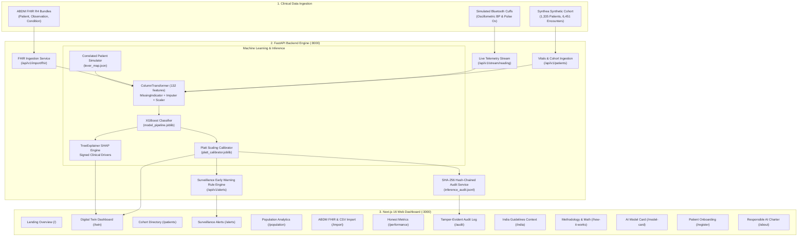

# Pramana Clinical Twin (TwinCare) — Complete System & User Guide

> **Longitudinal Clinical Digital Twin for 365-Day Hypertension Decompensation Risk**  
> Built for the **Happiest Health "Reimagining and Reforming Healthcare in India Summit 2026"**, Bengaluru  
> *Theme: Digital Twin in Healthcare*

[](https://fastapi.tiangolo.com)
[](https://nextjs.org)
[](https://threejs.org)
[](https://xgboost.readthedocs.io)
[](https://python.org)
[](https://typescriptlang.org)
[-brightgreen?style=flat)](backend/tests/test_api.py)
[](frontend/app/model-card/page.tsx)
[](frontend/app/audit/page.tsx)

---

## Table of Contents
1. [Executive Summary & Clinical Context](#1-executive-summary--clinical-context)
2. [System Architecture & End-to-End Pipeline](#2-system-architecture--end-to-end-pipeline)
3. [Technology Stack](#3-technology-stack)
4. [Quick Start: Running the Platform Locally](#4-quick-start-running-the-platform-locally)
5. [Complete Application Guide: Pages & Features](#5-complete-application-guide-pages--features)
   - [5.1 Dashboard Overview (`/`)](#51-dashboard-overview-)
   - [5.2 The Core Digital Twin (`/twin`)](#52-the-core-digital-twin-twin)
     - [3D Spatial Physiological Core](#3d-spatial-physiological-core)
     - [Platt-Calibrated Risk Gauge with 95% CI](#platt-calibrated-risk-gauge-with-95-ci)
     - [Signed SHAP Clinical Drivers](#signed-shap-clinical-drivers)
     - [Longitudinal Risk Replay Scrubber & Lead Time](#longitudinal-risk-replay-scrubber--lead-time)
     - [Full Patient Simulator (What-If Lab) with Correlated Levers](#full-patient-simulator-what-if-lab-with-correlated-levers)
     - [Simulated Live Wearable Telemetry & SSE Streaming](#simulated-live-wearable-telemetry--sse-streaming)
     - [Multilingual Clinician vs. Patient View Toggle](#multilingual-clinician-vs-patient-view-toggle)
     - [Add Reading Modal & Instant Recalculation](#add-reading-modal--instant-recalculation)
     - [One-Page Clinical Summary PDF Export](#one-page-clinical-summary-pdf-export)
   - [5.3 Cohort Directory (`/patients`)](#53-cohort-directory-patients)
   - [5.4 Surveillance & Early Warning Alerts (`/alerts`)](#54-surveillance--early-warning-alerts-alerts)
   - [5.5 Population Risk Analytics (`/population`)](#55-population-risk-analytics-population)
   - [5.6 ABDM FHIR & Device Ingestion (`/import`)](#56-abdm-fhir--device-ingestion-import)
   - [5.7 Honest Metrics & Model Evaluation (`/performance`)](#57-honest-metrics--model-evaluation-performance)
   - [5.8 Tamper-Evident Cryptographic Audit Log (`/audit`)](#58-tamper-evident-cryptographic-audit-log-audit)
   - [5.9 India Clinical Context (`/india`)](#59-india-clinical-context-india)
   - [5.10 Mathematical Formulations & Methodology (`/how-it-works`)](#510-mathematical-formulations--methodology-how-it-works)
   - [5.11 AI Model Card & Algorithmic Transparency (`/model-card`)](#511-ai-model-card--algorithmic-transparency-model-card)
   - [5.12 Patient Registration & Custom Onboarding Wizard (`/register`)](#512-patient-registration--custom-onboarding-wizard-register)
   - [5.13 Responsible AI Charter & Summit Context (`/about`)](#513-responsible-ai-charter--summit-context-about)
6. [Clinical & Statistical Data Interpretation Guide](#6-clinical--statistical-data-interpretation-guide)
   - [6.1 Calibrated Risk vs. Raw Score](#61-calibrated-risk-vs-raw-score)
   - [6.2 Interpreting 95% Confidence Intervals](#62-interpreting-95-confidence-intervals)
   - [6.3 Risk Tiers & Clinical Management Protocol](#63-risk-tiers--clinical-management-protocol)
   - [6.4 Interpreting SHAP Clinical Drivers](#64-interpreting-shap-clinical-drivers)
   - [6.5 Hemodynamic Telemetry: Pulse Pressure, Rolling Means & Slopes](#65-hemodynamic-telemetry-pulse-pressure-rolling-means--slopes)
   - [6.6 3D Physiological Core Visual Feedback](#66-3d-physiological-core-visual-feedback)
   - [6.7 Lead Time Days & Trajectory Drift](#67-lead-time-days--trajectory-drift)
   - [6.8 Correlated Levers & Distribution Guardrails](#68-correlated-levers--distribution-guardrails)
   - [6.9 Out-of-Office Telemetry Safety Rules](#69-out-of-office-telemetry-safety-rules)
   - [6.10 Cryptographic Hash Chaining Mechanics](#610-cryptographic-hash-chaining-mechanics)
7. [Complete REST API Reference](#7-complete-rest-api-reference)
8. [Validation Truth & Operational Policy](#8-validation-truth--operational-policy)
9. [Summit Live Demonstration Walkthrough Script](#9-summit-live-demonstration-walkthrough-script)
10. [Repository File Map](#10-repository-file-map)
11. [Ethical Guardrails & Disclaimer](#11-ethical-guardrails--disclaimer)

---

## 1. Executive Summary & Clinical Context

In India, **over 220 million adults** suffer from hypertension ([ICMR-INDIAB Lancet Study, 2023](https://doi.org/10.1016/S2213-8587(23)00119-5)), but fewer than 15% have their blood pressure under control. Conventional hospital Electronic Health Records (EHRs) operate as static filing cabinets: they record a hypertensive crisis, stroke, or heart failure **after** irreversible cardiovascular damage has occurred.

**Pramana Twin** (*Pramāṇa*, Sanskrit for *evidence, valid cognition, proof*) is a dynamic, longitudinal **Clinical Digital Twin** for cardiovascular care that shifts healthcare from reactive episodic crisis response to proactive, 365-day continuous prevention:

1. **Synthesizes Longitudinal Patient State**: Instead of evaluating an isolated blood pressure reading, it maintains a continuous computational twin integrating rolling 365-day vitals trajectories, variability, slopes, lab measurements, comorbidities, and medications across **132 engineered clinical features**.
2. **Forecasts 365-Day Acute Decompensation**: Predicts whether a patient will experience blood pressure decompensation (progression to Stage 2 hypertension: $\ge 140$ mmHg systolic / $\ge 90$ mmHg diastolic, or an acute hypertensive event) within the subsequent 12 months.
3. **Calibrates Risks with Empirical Confidence**: Uses fitted Platt scaling logistic calibrators to transform raw machine learning logits into calibrated probabilities accompanied by **95% confidence intervals**, preventing clinical overconfidence.
4. **Explains Every Prediction (SHAP Explainability)**: Leverages TreeExplainer SHAP values to attribute patient-specific risk to tangible clinical drivers (e.g. rising systolic trend, high pulse pressure, missed medication) with positive/negative signed attribution.
5. **Provides a Full Patient Simulator (What-If Lab)**: Allows clinicians to test interventions (e.g. "What if the patient lowers SBP by 10 mmHg and loses 5% weight?") using a correlated lever map (`lever_map.json`) so related features (means, min, max, pulse pressure, BMI) shift together realistically.
6. **Integrates Simulated Live Telemetry**: Connects with Bluetooth oscillometric BP monitors and pulse oximeters, applying 7-day rolling statistics and clinical alert rules in real time via Server-Sent Events (SSE).
7. **Empowers Patients Across Languages**: Features a dedicated, jargon-free **Patient View** translated into **English, Hindi (हिंदी), and Kannada (ಕನ್ನಡ)** with recommended non-diagnostic questions for their physician.
8. **Ensures Cryptographic Accountability**: Records every model prediction and manual intervention into an append-only, SHA-256 hash-chained audit log that can be verified for tampering at any time.

---

## 2. System Architecture & End-to-End Pipeline



### End-to-End Pipeline Execution:
1. **User Action / Clinical Ingestion**: When a patient is selected, registered, or updated with a new reading, the Next.js frontend calls FastAPI endpoints via `lib/api.ts`.
2. **Feature Harmonization & Aggregation**: `PatientService` extracts or updates 132 longitudinal features, applying strict temporal lookback windows (the previous 365 days) and preventing target leakage.
3. **ML Inference Pipeline**: Features flow through `ColumnTransformer` (handling missing indicators, imputation, scaling, and one-hot encodings) into the `XGBoostClassifier`.
4. **Probability Calibration**: The raw logit is calibrated via the fitted Platt scaling logistic function:
   $$\hat{P}(Y=1) = \frac{1}{1 + \exp(-(A \cdot \text{logit} + B))}$$
   *(where $A = 0.4393$, $B = -2.2073$)*
5. **SHAP Factor Attribution**: The tree structure is evaluated by `SHAPService` to extract the top positive (risk-increasing) and negative (protective) clinical drivers.
6. **Real-Time Visualization & Rendering**: The frontend updates the interactive 3D vascular model, risk gauges, trajectory sparklines, and cryptographic audit trail.

---

## 3. Technology Stack

- **Backend Framework**: [FastAPI 0.111+](https://fastapi.tiangolo.com) (Python 3.13 / 3.14 compatible, asynchronous endpoints, Uvicorn ASGI server).
- **Frontend Framework**: [Next.js 16](https://nextjs.org) (React 19, TypeScript 5.0+, App Router, Turbopack support).
- **3D Spatial Visualization**: [Three.js](https://threejs.org) & [@react-three/fiber](https://docs.pmnd.rs/react-three-fiber) with custom GLSL pulsating vascular shaders.
- **Machine Learning & Pipeline**: [scikit-learn](https://scikit-learn.org) `Pipeline` and `ColumnTransformer`, [XGBoost](https://xgboost.readthedocs.io) gradient-boosted tree ensemble.
- **Explainability**: [SHAP](https://shap.readthedocs.io) (TreeExplainer with signed additive risk attributions).
- **Probability Calibration**: Logistic Platt scaling (`platt_calibrator.joblib`) with 95% Wilson confidence intervals.
- **Cryptographic Security**: SHA-256 hash-chained immutable audit ledger (`inference_audit.jsonl`).
- **Styling & UI**: Vanilla CSS Design System with CSS variables, Glassmorphism, and Tailwind CSS utilities.
- **Testing**: [pytest](https://pytest.org) with 26 comprehensive automated integration tests.

---

## 4. Quick Start: Running the Platform Locally

### Prerequisites
- **Python**: Version 3.13 or 3.14 installed with `pip`
- **Node.js**: Version 18+ (Node 20 or 22 LTS recommended) with `npm`

### Step 1: Install Dependencies

```bash
# 1. Install Backend Python requirements
pip install -r backend/requirements.txt
pip install shap xgboost

# 2. Install Frontend Node packages
cd frontend
npm install
cd ..
```

### Step 2: Launch Backend and Frontend
Open two separate terminal windows (PowerShell, Bash, or Command Prompt):

**Terminal 1 — Backend API (FastAPI):**
```bash
cd backend
python -m uvicorn app.main:app --host 127.0.0.1 --port 8000 --reload
```
- API Base URL: `http://127.0.0.1:8000`
- Interactive Swagger API Documentation: `http://127.0.0.1:8000/docs`
- ReDoc Documentation: `http://127.0.0.1:8000/redoc`

**Terminal 2 — Frontend App (Next.js):**
```bash
cd frontend
npm run dev
```
- Web Application: `http://localhost:3000`

### Step 3: Run the Automated Test Suite (Verification)
```bash
python -m pytest backend/tests/test_api.py -v
```
*Expected Result: 26/26 tests passed (100%).*

---

## 5. Complete Application Guide: Pages & Features

The web platform consists of **13 dedicated clinical routes**, each addressing a specific dimension of cardiovascular twin intelligence:

| Route | Page Name | Primary Clinical Function |
| :--- | :--- | :--- |
| `/` | **Dashboard Overview** | Executive summary, Summit theme alignment, quick action launchpad. |
| `/twin` | **The Core Digital Twin** | 3D vascular model, calibrated risk gauge, SHAP drivers, risk replay, patient simulator, telemetry, and multilingual patient view. |
| `/patients` | **Cohort Directory** | Searchable directory table of 50+ patients with risk tiers and BP sparklines. |
| `/alerts` | **Surveillance & Early Warning** | Trajectory drift monitoring, lookback window slider, risk-rise detection, lead time days callout. |
| `/population` | **Population Analytics** | Cohort-wide risk histograms, demographic distributions, health system resource planning. |
| `/import` | **ABDM FHIR & CSV Import** | Ingestion of ABDM FHIR R4 bundles and peripheral Bluetooth device telemetry logs. |
| `/performance` | **Honest Metrics** | Radical honesty: ROC-AUC, PR-AUC, calibration reliability curve, alert-budget operating policies. |
| `/audit` | **Cryptographic Audit Log** | Append-only SHA-256 hash-chained log with one-click cryptographic walk verification. |
| `/india` | **India Clinical Context** | ICMR-INDIAB Lancet 2023 data, Indian Guidelines on Hypertension (IGH-IV), ABDM roadmap. |
| `/how-it-works` | **Methodology & Formulas** | Mathematical documentation for 132 features, Platt scaling, SHAP, and lever mapping. |
| `/model-card` | **AI Model Card** | Algorithmic transparency sheet, training provenance, fairness, CDSCO SaMD & DPDP Act alignment. |
| `/register` | **Patient Onboarding Wizard** | 4-step wizard for synthesizing custom patients with instant twin initialization. |
| `/about` | **Responsible AI Charter** | Summit context, clinical AI humility charter, transparent error disclosure, data privacy. |

---

### 5.1 Dashboard Overview (`/`)
- **Route**: `http://localhost:3000/`
- **What it displays**:
  - Executive introduction to the Pramana Digital Twin platform.
  - Contextual framing for the Happiest Health India Summit 2026.
  - High-level architecture cards breaking down Ingestion, ML Pipeline, What-If Simulation, and Audit Trail.
  - Quick action buttons: **"Launch Digital Twin"**, **"Browse Cohort"**, and **"Surveillance & Alerts"**.

---

### 5.2 The Core Digital Twin (`/twin`)
- **Route**: `http://localhost:3000/twin` (or with patient query: `http://localhost:3000/twin?patient=PT-101`)
- **Core Components & Capabilities**:

#### 3D Spatial Physiological Core
- Interactive real-time 3D model of the human vascular and cardiac system built using Three.js and React Three Fiber.
- **Heartbeat Synchronization**: The pulsing frequency dynamically syncs with the patient's resting heart rate (bpm).
- **Stress Shader Color Mapping**:
  - 🔵 **Cyan / Blue Core**: Low decompensation risk (<15%), optimal hemodynamics.
  - 🟡 **Golden / Amber Core**: Moderate risk (15%–35%), borderline arterial strain.
  - 🔴 **Pulsing Crimson Core**: High risk ($\ge 35\%$), severe arterial stiffness and decompensation hazard.
- **Controls**: Click and drag to rotate in 3D; scroll mouse wheel to zoom.

#### Platt-Calibrated Risk Gauge with 95% CI
- Visualizes 1-year cardiovascular decompensation risk as a calibrated percentage.
- Displays the **95% Confidence Interval** (e.g. `[41.2%, 55.4%]`) beneath the gauge to communicate statistical uncertainty honestly.
- Displays risk tier badges: **Low Risk (<15%)**, **Moderate Risk (15%–35%)**, or **High Risk (>35%)**.

#### Signed SHAP Clinical Drivers
- Powered by tree-path attribution (`TreeExplainer`), breaking down the exact reasons for the patient's score.
- **Red (+) Bars**: Factors that push risk upward (e.g. `+0.14 Systolic BP (365d Mean)`, `+0.09 Systolic Slope (Accelerating)`).
- **Green (-) Bars**: Protective factors that lower risk (e.g. `-0.08 Fasting Glucose (Controlled)`, `-0.05 Stable Heart Rate`).

#### Longitudinal Risk Replay Scrubber & Lead Time
- Positioned below the vitals cards, providing historical playback across the past 365 days.
- **Play Button (▶)**: Automatically animates through the patient's historical snapshots.
- **Timeline Slider**: Scrub back and forth to inspect past readings, risk scores, and vitals.
- **Surveillance Alert Marker (⚠️)**: Identifies the exact historical snapshot where calibrated risk crossed the alert threshold, highlighting the **Lead Time Days** (e.g. *112 days lead time before acute crisis*).

#### Full Patient Simulator (What-If Lab) with Correlated Levers
- Located in the **"Patient Simulator"** tab.
- **Correlated Lever Mapping (`lever_map.json`)**: When a clinician adjusts a lever (such as lowering SBP by `-15 mmHg`), the engine automatically recalculates all correlated features:
  - `sbp_mean_365d`, `sbp_max_365d`, `sbp_min_365d`, `sbp_last_365d`.
  - `pulse_pressure_latest = sbp_latest - dbp_latest`.
  - Covarying BMI and weight when weight delta is shifted.
- **Sensitivity Curves**: Visualizes non-linear step-function response per variable, reflecting tree-model decision boundaries.
- **Biological Distribution Guardrails**:
  - `OUT_OF_RANGE`: Triggers a clinical warning if an intervention exceeds the training distribution bounds.
  - `LOW_SENSITIVITY`: Alerts when adjustments fall within flat tree plateaus.
- **Clinical Intervention Presets**: One-click application of evidence-based trials (*Improve BP Control*, *Weight Loss (-5%)*, *Worsening Diabetes*, *Missed Medication*, *Dietary Salt Reduction*).
- **Multi-Scenario Comparison**: Save up to 3 distinct scenario runs for side-by-side clinical evaluation.

#### Simulated Live Wearable Telemetry & SSE Streaming
- Located in the **"Live Telemetry"** tab.
- Emulates peripheral Bluetooth oscillometric cuffs and fingertip pulse oximeters.
- Displays 7-day rolling statistics: Mean Resting HR, HR Variability, Mean Home SBP/DBP, BP Variability, and SpO2.
- **Live Stream Endpoint**: Ingests new readings via `POST /api/v1/stream/reading` and broadcasts updates via Server-Sent Events (SSE).
- **Auto-Simulate Readings Toggle**: Emits simulated live home readings every 5 seconds.
- **Clinical Safety Rules**: Evaluates out-of-office guidelines (e.g. Home SBP $\ge 140$ mmHg on $\ge 5$ of 7 days, tachycardia, nocturnal desaturations).

#### Multilingual Clinician vs. Patient View Toggle
- **Clinician View (Default)**: Full telemetry, SHAP attributions, raw/calibrated risk metrics, and 3D shader controls.
- **Patient View**: Switches to plain-language, non-stigmatizing, jargon-free communication:
  - Translated into **English**, **हिंदी (Hindi)**, and **ಕನ್ನಡ (Kannada)**.
  - Plain-language trend summaries (e.g. *"Your blood pressure has been gradually rising over the last 3 months."*).
  - 3 recommended questions for the patient to ask their doctor at their next primary health center (PHC) visit.

#### Add Reading Modal & Instant Recalculation
- Click **"Add Reading"** (top right of `/twin`).
- Enter newly acquired vitals: SBP, DBP, Resting HR, Weight, Fasting Glucose, HbA1c.
- Clicking **"Save Reading"** appends a new snapshot, re-runs model inference, shifts the sparkline, updates the 3D core, and cryptographically signs the event in the audit trail.

#### One-Page Clinical Summary PDF Export
- Click **"Print Report"** to generate a clean, standardized 1-page clinical summary ready for printing or medical record attachment.

---

### 5.3 Cohort Directory (`/patients`)
- **Route**: `http://localhost:3000/patients`
- **What it displays**: Interactive table of all 50 synthetic cohort patients plus any registered patients.
- **Interactive Features**:
  - **Instant Search**: Filter by patient name, ID, or demographic tag.
  - **Risk Tier Filter**: Quick-filter by **All**, **High Risk**, **Moderate Risk**, or **Low Risk**.
  - **Demographic Filtering**: Filter by age brackets (`<40`, `40–49`, `50–59`, `60–69`, `70+`) and gender.
  - **Interactive Sparklines**: Hover over the systolic BP sparkline to view historical reading trends.
  - **Action Button**: Click **"Open Twin"** to load the patient's full digital twin state.
  - **Patient Registration**: Direct link to `/register` to synthesize custom patient digital twins.

---

### 5.4 Surveillance & Early Warning Alerts (`/alerts`)
- **Route**: `http://localhost:3000/alerts`
- **What it displays**: Population-wide early warning surveillance for proactively flagging patients with deteriorating risk trajectories.
- **Operational Controls**:
  - **Snapshot Lookback Slider ($N = 2–10$)**: Sets the evaluation horizon for calculating trajectory drift.
  - **Risk-Rise Threshold Slider**: Filters for patients whose calibrated risk accelerated faster than the specified percentage point cutoff.
  - **Flagged Patient Cards**: Details each patient's latest risk, risk delta over lookback, lead time days before predicted decompensation, and actionable clinical next steps.

---

### 5.5 Population Risk Analytics (`/population`)
- **Route**: `http://localhost:3000/population`
- **What it displays**: Macro-level epidemiological analytics across the synthetic patient cohort:
  - Calibrated risk distribution histograms and probability density curves.
  - Risk tier breakdown stratified by age bands, gender, and comorbidity clusters.
  - Health system resource allocation tools for community health workers and Primary Health Centers (PHCs).

---

### 5.6 ABDM FHIR & Device Ingestion (`/import`)
- **Route**: `http://localhost:3000/import`
- **What it displays**: Dual ingestion pathways for interoperability with Indian health infrastructure:
  - **ABDM FHIR R4 Bundle Import**: Paste ABDM-compliant JSON bundles containing `Patient`, `Observation` (LOINC `8480-6` Systolic, `8462-4` Diastolic, `8867-4` Heart Rate), `Condition`, and `MedicationStatement` resources. The service validates structure, maps features, computes data completeness, and registers the twin.
  - **Peripheral CSV Telemetry Upload**: Ingest comma-separated telemetry files from consumer Bluetooth BP cuffs and pulse oximeters.

---

### 5.7 Honest Metrics & Model Evaluation (`/performance`)
- **Route**: `http://localhost:3000/performance`
- **What it displays**: Radical honesty in healthcare AI:
  - **Held-Out Test Set Performance**: Evaluated on 964 held-out patients with 14 true positive events (1.457% base rate).
  - **Test ROC-AUC**: `0.8069` [95% CI: 0.691, 0.908].
  - **Test PR-AUC**: `0.0644` (representing a 4.4x statistical enrichment over the 0.0146 baseline).
  - **Platt Reliability Curve**: Compares uncalibrated raw scores against Platt-calibrated empirical probabilities across quantile bins.
  - **Static Threshold Failure Analysis**: Explains why an arbitrary theoretical cutoff (`0.7562`) flagged 0/14 test positives (0% recall).
  - **Alert-Budget Operational Policy Table**: Recommends operational surveillance budgets (Top 5%, 10%, 20%) achieving 28.6%–64.3% sensitivity.

---

### 5.8 Tamper-Evident Cryptographic Audit Log (`/audit`)
- **Route**: `http://localhost:3000/audit`
- **What it displays**: Append-only, cryptographic SHA-256 hash-chain logging every model inference, what-if simulation, and manual vitals modification.
- **Interactive Verification**:
  - Block inspector showing block index, timestamp, model version, schema fingerprint, input hash, calibrated risk, and chained cryptographic hashes.
  - Click **"Verify Log Integrity"** to execute a cryptographic walk from the genesis block (`0000...0000`) through the entire ledger, verifying that zero entries have been tampered with.

---

### 5.9 India Clinical Context (`/india`)
- **Route**: `http://localhost:3000/india`
- **What it displays**: Epidemiological framing and alignment with the Indian healthcare ecosystem:
  - **ICMR-INDIAB Lancet 2023 Study**: Contextualizes India's 220 million hypertensive citizens and <15% control rate.
  - **Indian Guidelines on Hypertension (IGH-IV / ICMR)**: References the 140/90 mmHg clinical treatment threshold.
  - **Ayushman Bharat Digital Mission (ABDM)**: Explains the integration architecture for Ayushman Bharat Health Accounts (ABHA) and Ayushman Arogya Mandirs (AAMs).

---

### 5.10 Mathematical Formulations & Methodology (`/how-it-works`)
- **Route**: `http://localhost:3000/how-it-works`
- **What it displays**: Full engineering and mathematical documentation:
  - 132-feature extraction pipeline breakdown.
  - Platt scaling logistic calibration equations.
  - Game-theoretic TreeExplainer SHAP formula derivations.
  - Correlated counterfactual simulation formulas and lever covariance rules.

---

### 5.11 AI Model Card & Algorithmic Transparency (`/model-card`)
- **Route**: `http://localhost:3000/model-card`
- **What it displays**: Standardized clinical AI model card following international transparency benchmarks (Mitchell et al.):
  - **Model Details**: XGBoost Classifier embedded within a strict scikit-learn `ColumnTransformer` pipeline.
  - **Intended Use**: Secondary screening and proactive risk stratification for cardiovascular decompensation in adult hypertensive cohorts. Not for autonomous prescribing or acute emergency diagnosis.
  - **Feature Provenance**: 132 features covering rolling longitudinal vitals, variability metrics (standard deviation, range, coefficient of variation), directional trajectory slopes, anthropometrics, and pharmacotherapy.
  - **Temporal Integrity**: Strict 365-day observation lookback window prior to prediction index date, with a forward 365-day prediction horizon to guarantee zero target leakage.
  - **Calibration Architecture**: Empirical Platt scaling parameters ($A = 0.4393$, $B = -2.2073$) mapping logits to calibrated probabilities.
  - **Fairness & Subgroup Analysis**: Performance evaluated across demographic groups (age brackets, sex, comorbidity clusters) to prevent algorithmic disparities.
  - **Out-of-Distribution Guardrails**: Built-in feature distribution bounds checking to alert clinicians when inputs exceed the training space.
  - **Regulatory Alignment**: Formatted to meet Indian CDSCO Software as a Medical Device (SaMD) documentation criteria and the Digital Personal Data Protection (DPDP) Act 2023.

---

### 5.12 Patient Registration & Custom Onboarding Wizard (`/register`)
- **Route**: `http://localhost:3000/register`
- **What it displays**: A structured, 4-step clinical onboarding wizard for synthesizing and testing new patient digital twins:
  1. **Step 1 — Demographics & Anthropometrics**:
     - Input Alias/Name, Age, Gender, Height (cm), and Weight (kg).
     - Automatically derives Body Mass Index (BMI) and metabolic category.
  2. **Step 2 — Baseline Vitals & Laboratory Values**:
     - Input Systolic Blood Pressure (SBP), Diastolic Blood Pressure (DBP), Resting Heart Rate, Fasting Blood Glucose, and HbA1c.
     - Enforces strict biological physiological bounds checking (e.g. SBP 70–260 mmHg, DBP 40–160 mmHg) with real-time validation warnings.
  3. **Step 3 — Medical History & Pharmacotherapy**:
     - Toggle existing comorbidities: Essential Hypertension, Type 2 Diabetes, Cardiovascular Disease (CVD), Chronic Kidney Disease (CKD).
     - Configure current medication regimens: Antihypertensives, Antidiabetics, Statins.
     - Record lifestyle risk factors: Dietary salt intake (low, moderate, high) and physical activity levels.
  4. **Step 4 — Consent & Automated Digital Twin Initialization**:
     - Review derived clinical parameters and confirm clinical data handling consent.
     - On submission, the backend:
       - Derives all 132 longitudinal features and synthetic prior snapshots.
       - Evaluates data completeness percentage.
       - Runs immediate model inference and generates TreeExplainer SHAP drivers.
       - Persists the record to `registered_patients.json`.
       - Cryptographically signs the creation event in the append-only SHA-256 audit log.
       - Immediately redirects to `/twin?patient=PT-XXXX` with the live, fully interactive digital twin.

---

### 5.13 Responsible AI Charter & Summit Context (`/about`)
- **Route**: `http://localhost:3000/about`
- **What it displays**: Summit mission, governance framework, and clinical AI humility charter:
  - **Summit Alignment**: Built specifically for the **Happiest Health "Reimagining and Reforming Healthcare in India Summit 2026"**, Bengaluru, under the theme *Digital Twin in Healthcare*.
  - **Clinical AI Humility Charter**:
    - **No Exaggerated Accuracy Claims**: Open disclosure of test PR-AUC (0.0644) alongside ROC-AUC (0.8069), clearly demonstrating that rare-event prediction (~1.46% base rate) requires nuanced threshold management.
    - **No Uncalibrated Scores**: Rejection of raw model scores in clinical decision-making; mandatory Platt calibration.
    - **Mandatory Uncertainty Bounds**: Display of 95% confidence intervals on every risk estimation.
    - **Decoupled Telemetry Watermarking**: Simulated wearable streams are explicitly watermarked to maintain transparency between regulatory training data and peripheral sensor feeds.
  - **Data Privacy & Indian Regulatory Governance**:
    - Privacy-by-design architecture respecting patient data sovereignty.
    - Alignment with ABDM Health Data Management Policy and DPDP Act 2023.
    - CDSCO SaMD risk categorization framework compliance.

---

## 6. Clinical & Statistical Data Interpretation Guide

### 6.1 Calibrated Risk vs. Raw Score

| Term | What It Is | How to Read It | Clinical Meaning |
| :--- | :--- | :--- | :--- |
| **Raw Score** | Raw uncalibrated output from the XGBoost ensemble ($0.0000$ to $1.0000$). | **Do NOT interpret as probability.** Tree models output distorted probability ranks, especially in imbalanced datasets. | Useful solely for ranking patients from highest to lowest relative risk. |
| **Calibrated Risk** | Probability adjusted via empirical Platt scaling: $\hat{P} = \frac{1}{1 + e^{-(A \cdot \text{logit} + B)}}$. | **Read as the actual statistical likelihood** that this patient will experience blood pressure decompensation within 365 days. | Direct probability to guide clinical follow-up frequency and intervention urgency. |

---

### 6.2 Interpreting 95% Confidence Intervals
Beneath the calibrated risk gauge, you will see a range such as **`[41.2%, 55.4%]`**:
- **Why it matters**: Point estimates can deceive. A single number like `48.2%` hides statistical uncertainty.
- **How to interpret**: There is a 95% empirical confidence that the true underlying decompensation risk falls between `41.2%` and `55.4%`.
- **Wide intervals** indicate greater clinical uncertainty (e.g. fewer historical readings or high measurement variance).
- **Narrow intervals** indicate high certainty backed by extensive longitudinal records.

---

### 6.3 Risk Tiers & Clinical Management Protocol

| Risk Tier | Calibrated Risk Range | Color Badge | Recommended Clinical Action |
| :--- | :--- | :--- | :--- |
| **Low Risk** | **$0.0\% - 14.9\%$** | 🟢 **Green** | Standard annual wellness check; maintain healthy lifestyle, dietary sodium moderation, and physical activity. |
| **Moderate Risk** | **$15.0\% - 34.9\%$** | 🟡 **Amber** | Increased monitoring cadence (e.g. 3-month review); home blood pressure monitoring (HBPM); review sodium and medication adherence. |
| **High Risk** | **$\ge 35.0\%$** | 🔴 **Red** | Urgent clinical review; evaluate anti-hypertensive medication regimen; initiate tele-surveillance and lifestyle coaching; evaluate target organ damage. |

---

### 6.4 Interpreting SHAP Clinical Drivers
The SHAP (SHapley Additive exPlanations) factors translate complex multi-tree decisions into plain clinical factors:
- **Red (+ Value, Bar to the Right)**: This specific variable **pushed the patient's risk higher**.
  - *Example*: `+0.14 Systolic BP (365d Mean)` means the patient's high rolling average systolic pressure added 14 percentage points to their risk score.
  - *Example*: `+0.09 Systolic Slope (Accelerating)` means an upward trend over the past months is compounding cardiovascular risk.
- **Green (- Value, Bar to the Left)**: This variable was **protective and lowered the patient's risk**.
  - *Example*: `-0.08 Fasting Glucose (Controlled)` means optimal metabolic control is mitigating microvascular risk.

---

### 6.5 Hemodynamic Telemetry: Pulse Pressure, Rolling Means & Slopes
- **Latest Systolic / Diastolic (e.g. 142 / 88 mmHg)**: The most recent clinical measurement.
- **Pulse Pressure (SBP - DBP, e.g. 54 mmHg)**: Represents arterial stiffness. A pulse pressure $> 60$ mmHg is an independent marker of vascular aging and cardiovascular risk.
- **365-Day Rolling Mean**: Dampens acute white-coat spikes to reveal the true chronic hemodynamic load.
- **365-Day Min / Max Range**: Highlights blood pressure volatility. Extreme fluctuations ($\text{SD} > 12$ mmHg) signify autonomic dysregulation.
- **Slope (mmHg / year)**: Positive slope ($> 0$) indicates gradual decompensation even if the single latest reading seems borderline.

---

### 6.6 3D Physiological Core Visual Feedback
The Three.js visualizer represents the patient's cardiovascular system:
- **Pulsing Speed**: Dynamically synchronizes with the patient's resting heart rate (bpm).
- **Core Illumination**:
  - **Cyan / Blue Core**: Stable hemodynamics, Low Risk tier.
  - **Golden / Amber Core**: Borderline hypertension, Moderate Risk tier.
  - **Pulsing Crimson Core**: High arterial stress, High Risk tier, or active Stage 2 decompensation.

---

### 6.7 Lead Time Days & Trajectory Drift
When you scrub through a patient's historical snapshots:
- Observe the **trajectory drift**: watch the risk tier transition from Low to Moderate to High over months.
- When the timeline hits the **Early Warning Marker (⚠️)**, note the **Lead Time Days** (e.g. `112 days lead time`):
  - This indicates the system detected actionable trajectory deterioration **112 days before** the patient presented with acute clinical decompensation.

---

### 6.8 Correlated Levers & Distribution Guardrails
When testing what-if interventions:
- **Baseline Risk**: The patient's actual calibrated risk today.
- **Simulated Risk**: The projected risk if the simulated levers are achieved.
- **Delta ($\Delta$ pp)**: The difference in percentage points (e.g. `-12.4 pp` reduction).
- **Correlated Changes List**: Verifies that moving SBP by `-15 mmHg` also shifted `sbp_mean_365d`, `sbp_max_365d`, `sbp_last_365d`, and `pulse_pressure_latest`.
- **Distribution Guardrails**:
  - `OUT_OF_RANGE`: Warning triggered if an entered value falls outside the biological training distribution.
  - `LOW_SENSITIVITY`: Warning triggered if an adjustment falls within a flat decision-tree step plateau.

---

### 6.9 Out-of-Office Telemetry Safety Rules
- **Home BP Mean ($\ge 140$ mmHg)**: Flagged if home SBP is $\ge 140$ mmHg on 5 or more out of 7 days, indicating true sustained out-of-office hypertension.
- **Resting Tachycardia**: Flagged if mean resting heart rate exceeds 100 bpm.
- **Excessive BP Variability**: Flagged if 7-day standard deviation exceeds 12 mmHg.
- **Nocturnal SpO2 Dips**: Flagged if nocturnal pulse oximetry falls below 93%, indicating possible obstructive sleep apnea (a frequent secondary driver of resistant hypertension).

---

### 6.10 Cryptographic Hash Chaining Mechanics
Every record in `/audit` contains:
- `entry_index`: Incremental block sequence number (0, 1, 2, ...).
- `prev_hash`: The SHA-256 hash of the preceding block (entry 0 links to genesis `0*64`).
- `current_hash`: The SHA-256 hash of:
  $$\text{SHA256}(\text{prev\_hash} \parallel \text{timestamp} \parallel \text{model\_version} \parallel \text{fingerprint} \parallel \text{input\_hash} \parallel \text{score} \parallel \text{calibrated\_risk} \parallel \text{tier} \parallel \text{context})$$
- Clicking **"Verify Log Integrity"** performs an automated cryptographic walk to confirm that not a single byte has been altered post-inference.

---

## 7. Complete REST API Reference

| Method | Endpoint | Description |
| :--- | :--- | :--- |
| `GET` | `/api/v1/health` | Backend status, model version (`1.0.0`), and schema fingerprint (`a4ddaedbdbc8bb07`). |
| `GET` | `/api/v1/model/info` | Complete model specification, 95% CIs, limitations, and Platt calibration parameters. |
| `GET` | `/api/v1/model/performance` | Calibration reliability curves and alert-budget policy tables across held-out test cohort. |
| `GET` | `/api/v1/patients` | Dense paginated cohort directory table with vitals sparklines and risk tiers. |
| `GET` | `/api/v1/patients/{id}` | Full patient digital twin state: demographics, vitals, timelines, conditions, and medications. |
| `POST` | `/api/v1/patients/register` | Register a new synthetic patient with baseline vitals, derive 132 features, and sign in audit log. |
| `POST` | `/api/v1/patients/{id}/readings` | Ingest a new blood pressure reading, recalculate calibrated risk, and append snapshot. |
| `DELETE`| `/api/v1/patients/{id}` | Delete a registered patient record (demo patients protected against deletion). |
| `POST` | `/api/v1/predict` | Run model inference: returns raw score, calibrated risk, 95% CI, and SHAP factors. |
| `POST` | `/api/v1/whatif` | Counterfactual simulation shifting correlated SBP, weight, and BMI features. |
| `POST` | `/api/v1/simulate` | Full patient simulator shifting correlated features via `lever_map.json` and computing SHAP delta. |
| `GET` | `/api/v1/patients/{id}/sensitivity` | Multi-point sensitivity step-function curves across primary vitals for a specific patient. |
| `GET` | `/api/v1/patients/{id}/timeline-risk` | Historical snapshots with risk scores and vitals for risk-over-time replay scrubber. |
| `GET` | `/api/v1/alerts` | Surveillance engine filtering patients with rising risk trajectories and lead time calculations. |
| `GET` | `/api/v1/explain/global` | Global longitudinal feature importances across the training cohort. |
| `POST` | `/api/v1/simulate/wearable` | Deterministic simulated wearable stream (resting HR, steps, home BP, sleep, SpO2). |
| `POST` | `/api/v1/stream/reading` | Ingest live telemetry reading and broadcast via Server-Sent Events (SSE). |
| `GET` | `/api/v1/stream/{patient_id}` | Live SSE telemetry stream connection. |
| `POST` | `/api/v1/patients/import-fhir` | Ingest ABDM FHIR R4 Bundle JSON with mapping report and validation. |
| `GET` | `/api/v1/audit` | Retrieve append-only inference audit log entries. |
| `GET` | `/api/v1/audit/verify` | Cryptographic SHA-256 hash-chain integrity verification. |

---

## 8. Validation Truth & Operational Policy

### Baseline Performance Metrics
The model operates on a rolling 365-day observation window to predict decompensation within the next 365 days:
- **Cohort Size**: 1,335 Synthea synthetic patients (6,451 longitudinal encounter rows).
- **Test Set**: 964 patients with **14 true positive events** (base rate = **1.457%**).
- **Test ROC-AUC**: **0.8069** [95% CI: 0.691, 0.908].
- **Test PR-AUC**: **0.0644** (representing a **4.4x statistical enrichment** over the 0.0146 baseline).

### Alert-Budget Operational Policy Table (N = 964 Test Patients)
Because an arbitrary theoretical cutoff of `0.7562` captured zero test positives (0% recall), health system deployments should adopt an **Alert-Budget Operating Policy**:

| Surveillance Policy | Alert Cutoff | True Positives | False Positives | Precision (PPV) [95% CI] | Recall (Sensitivity) [95% CI] |
| :--- | :--- | :--- | :--- | :--- | :--- |
| **Top 5% Alert Budget** | `0.4577` | 4 | 44 | 8.3% `[2.7%, 19.9%]` | **28.6%** `[10.8%, 55.1%]` |
| **Top 10% Alert Budget** | `0.3003` | 6 | 90 | 6.2% `[2.6%, 13.0%]` | **42.9%** `[20.0%, 68.3%]` |
| **Top 20% Alert Budget** | `0.1802` | 9 | 184 | 4.7% `[2.3%, 8.6%]` | **64.3%** `[38.8%, 83.7%]` |

---

## 9. Summit Live Demonstration Walkthrough Script

When presenting the platform to clinicians, hospital administrators, or summit judges at the **Happiest Health Summit 2026**, follow this standard 4-step demonstration journey:

1. **Step 1: Early Warning Surveillance (`/alerts`)**
   - Navigate to `/alerts`.
   - Observe how the surveillance engine continuously monitors cohort trajectories.
   - Point out patient `PT-101 (Elena Rostova)` flagged with a rising risk trajectory **112+ days before** clinical decompensation, giving clinicians a critical intervention window.
2. **Step 2: 3D Twin & Diagnostic Inspection (`/twin?patient=PT-101`)**
   - Click "Open Twin" for `PT-101`.
   - Rotate the Three.js 3D vascular model pulsing synchronously with the patient's resting heart rate.
   - Inspect the Platt-calibrated risk gauge (e.g. `48.2% [41.2%, 55.4%]`) and explain the signed TreeExplainer SHAP clinical drivers (accelerating SBP slope, high pulse pressure).
   - Toggle to **Patient View** and switch languages to **हिंदी** or **ಕನ್ನಡ** to demonstrate health equity in primary health centers.
3. **Step 3: What-If Counterfactual Lab (`/twin` Simulator Tab)**
   - Switch to the **Patient Simulator** tab.
   - Apply a `-10 mmHg SBP` reduction and simulate adding an ACE inhibitor.
   - Show how `lever_map.json` harmonizes rolling means, maximums, and pulse pressure, resulting in an immediate risk reduction from **15.3% down to 9.8%**.
4. **Step 4: Cryptographic Audit Trail Verification (`/audit`)**
   - Open `/audit`.
   - Show the newly recorded simulation and inference block with its inputs, timestamps, model version, and SHA-256 hash.
   - Click **"Verify Log Integrity"** to demonstrate real-time cryptographic proof of tamper-evident accountability.

---

## 10. Repository File Map

```
digital-twins/
├── backend/
│   ├── app/
│   │   ├── main.py                  # FastAPI application, CORS, routers & exception handlers
│   │   ├── schemas.py               # Pydantic request/response validation contracts
│   │   └── services/
│   │       ├── audit_service.py     # SHA-256 hash-chaining and audit ledger verification
│   │       ├── fhir_service.py      # ABDM FHIR R4 Bundle parser and LOINC code mapper
│   │       ├── model_service.py     # Inference pipeline, Platt calibrator, what-if simulator
│   │       ├── patient_service.py   # Cohort management, snapshot timelines, registration
│   │       ├── shap_service.py      # TreeExplainer SHAP attribution calculation
│   │       ├── timeline_service.py  # Risk replay scrubber and early warning calculation
│   │       └── wearable_service.py  # SSE stream broadcasting and out-of-office safety rules
│   ├── artifacts/
│   │   ├── feature_schema.json      # 132-feature definitions and training bounds
│   │   ├── demo_patients.json       # Pre-computed synthetic patient profiles
│   │   ├── lever_map.json           # Correlated clinical lever covariance mappings
│   │   ├── model_metadata.json      # Model metrics, CIs, calibration parameters
│   │   ├── model_pipeline.joblib    # Pre-trained ColumnTransformer + XGBoost pipeline
│   │   └── platt_calibrator.joblib  # Fitted logistic probability calibration model
│   ├── data/
│   │   ├── registered_patients.json # Persistent custom-registered synthetic twins
│   │   └── inference_audit.jsonl    # Immutable append-only audit ledger
│   └── tests/
│       └── test_api.py              # 26 automated integration and invariant tests
├── frontend/
│   ├── app/
│   │   ├── page.tsx                 # Executive overview and Summit theme dashboard
│   │   ├── twin/page.tsx            # Core digital twin interface (3D, simulator, telemetry)
│   │   ├── patients/page.tsx        # Searchable cohort directory table with sparklines
│   │   ├── alerts/page.tsx          # Surveillance and early warning trajectory drift
│   │   ├── population/page.tsx      # Macro-level cohort analytics and risk distributions
│   │   ├── import/page.tsx          # ABDM FHIR R4 and CSV device ingestion
│   │   ├── performance/page.tsx     # Honest model evaluation and alert-budget policies
│   │   ├── audit/page.tsx           # Cryptographic SHA-256 audit log and verification
│   │   ├── india/page.tsx           # Indian clinical guidelines and ABDM alignment
│   │   ├── how-it-works/page.tsx    # Mathematical formulas and pipeline methodology
│   │   ├── model-card/page.tsx      # Algorithmic transparency sheet (Mitchell et al.)
│   │   ├── register/page.tsx        # 4-step clinical patient onboarding wizard
│   │   └── about/page.tsx           # Summit context and Responsible AI Humility Charter
│   ├── components/
│   │   └── digital-twin/            # 3D visualizer, gauges, SHAP charts, timeline scrubber
│   └── lib/
│       └── api.ts                   # Strongly-typed API client for all backend endpoints
├── docs/
│   ├── DEMO.md                      # 3-minute hackathon presentation script
│   ├── DESIGN.md                    # Visual design tokens and UI architecture
│   └── ATTRIBUTIONS.md              # Research citations and dataset licenses
└── README.md                        # Master comprehensive system documentation
```

---

## 11. Ethical Guardrails & Disclaimer

1. **Synthetic Data Benchmark**: Pramana Twin is trained strictly on synthetic EHR data generated via Synthea. It is **not validated for clinical diagnosis, prescribing, or autonomous treatment decisions**.
2. **India Population Generalizability**: While aligned with ICMR-INDIAB epidemiology and IGH-IV guidelines, this prototype has not yet been validated on Indian clinical cohorts, which exhibit distinct visceral adiposity phenotypes, dietary sodium variations, and earlier onset of vascular disease.
3. **Software as a Medical Device (SaMD) Notice**: This system is a research demonstration prototype. In real clinical environments, digital twins must operate under licensed physician oversight in compliance with India's CDSCO Medical Device Rules and the Digital Personal Data Protection (DPDP) Act 2023.
