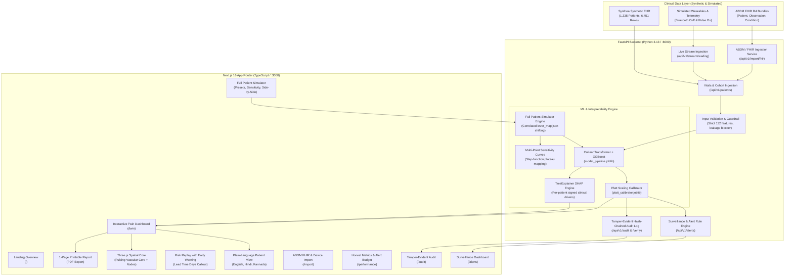

# Pramana Clinical Twin (TwinCare)

> **Longitudinal Clinical Digital Twin for 365-Day Hypertension Decompensation Risk**  
> Built for the **Happiest Health "Reimagining and Reforming Healthcare in India Summit 2026"**, Bengaluru  
> *Theme: Digital Twin in Healthcare*

[](https://fastapi.tiangolo.com)
[](https://nextjs.org)
[](https://threejs.org)
[](https://xgboost.readthedocs.io)
[](https://python.org)
[](https://typescriptlang.org)
[-brightgreen?style=flat)](backend/tests/test_api.py)

---

## 1. Executive Summary & Clinical Context

In India, hypertension affects more than **220 million individuals** ([ICMR-INDIAB Study, *The Lancet*, 2023](https://doi.org/10.1016/S2213-8587(23)00119-5)), yet fewer than 15% maintain optimal blood pressure control. Conventional Electronic Health Records (EHRs) act as retrospective filing cabinets—documenting clinical failures only after irreversible vascular damage has already occurred.

**Pramana Twin** (*Pramāṇa*, Sanskrit for *evidence, valid cognition, proof*) reimagines cardiovascular risk management through a dynamic, longitudinal **Clinical Digital Twin**:
- **Clinical Condition**: Essential Hypertension.
- **Target Outcome**: 365-Day Blood Pressure Decompensation (progression to Stage 2 hypertension, defined as systolic BP $\ge$ 140 mmHg / diastolic BP $\ge$ 90 mmHg, or a new hypertension diagnosis).
- **Inference History**: Rolling 365-day longitudinal clinical encounter history.
- **Machine Learning Architecture**: scikit-learn pipeline (`ColumnTransformer` + `XGBoostClassifier`, 132 features) calibrated via empirical Platt scaling into calibrated probabilities with 95% confidence intervals.
- **Explainability Engine**: TreeExplainer SHAP attribution translating complex EHR features into plain-English signed clinical drivers.
- **Full Patient Simulator**: Grouped input editor with correlated shifting via `lever_map.json`, multi-point sensitivity curves, 5 editable clinical presets, and side-by-side scenario comparison.
- **Live Simulated Telemetry**: Real-time reading ingestion (`POST /api/v1/stream/reading`) from low-cost Bluetooth BP cuffs and pulse oximeters, with 7-day rolling statistics and clinical alert rules.
- **Two Tailored Views**: Dense clinician dashboard vs. plain-language Patient View (available in English, Hindi, and Kannada).
- **India Healthcare Alignment**: Ayushman Bharat Digital Mission (ABDM) FHIR R4 Bundle ingestion prototype and Indian Guidelines on Hypertension (IGH-IV / ICMR) reference bands.
- **Core Truth & Transparency**: Built strictly on **Synthea synthetic EHR data** ($N = 1,335$ patients, $6,451$ observation rows, $14$ test positive events). Research prototype; non-diagnostic.

---

## 2. System Architecture



---

## 3. Quick Start & Execution

### Option A: One-Click Windows Launchers (Fastest)

Launch both services simultaneously using the pre-configured scripts:
1. Run `start_backend.bat` (Starts FastAPI on `http://localhost:8000`)
2. Run `start_frontend.bat` (Starts Next.js on `http://localhost:3000`)

---

### Option B: Local CLI via Makefile / Terminal

1. **Install Dependencies:**
   ```bash
   # Backend
   pip install -r backend/requirements.txt

   # Frontend
   cd frontend && npm install && cd ..
   ```

2. **Run Services (Separate Terminals):**
   ```bash
   # Terminal 1 — Backend API
   cd backend && python -m uvicorn app.main:app --reload --host 0.0.0.0 --port 8000

   # Terminal 2 — Frontend App
   cd frontend && npm run dev
   ```

3. **Verify Full-Stack Health:**
   ```bash
   # Pytest automated test suite (20/20 passing):
   python -m pytest backend/tests/test_api.py -v
   ```

---

### Option C: Docker Compose

Launch the containerized production stack with a single command:
```bash
docker compose up --build
```
- Stop containers: `docker compose down`

---

## 4. Application Endpoints & Workflows

| URL Path | Workflow | Key Clinical Features |
| :--- | :--- | :--- |
| [`/`](http://localhost:3000/) | **Clinical Overview & Thesis** | Summit theme framing, digital twin architecture breakdown, and quick action entry points. |
| [`/twin`](http://localhost:3000/twin) | **Interactive Twin Dashboard** | **The Core Digital Twin**: Clinician vs. Patient views, 3D physiological core, Platt-calibrated risk gauge, signed SHAP factors, longitudinal trajectory charts, Risk Replay with Early Warning marker, Full Patient Simulator, and Live Telemetry layer. |
| [`/alerts`](http://localhost:3000/alerts) | **Surveillance & Early Warning** | Monitors trajectory drift over configurable snapshot lookback windows ($N = 2–10$); displays lead time days before acute decompensation. |
| [`/import`](http://localhost:3000/import) | **ABDM FHIR & Device Ingestion** | Ingests ABDM-aligned FHIR R4 Bundles with validation and mapping reports; ingests low-cost Bluetooth BP cuff and pulse oximeter CSV feeds. |
| [`/patients`](http://localhost:3000/patients) | **Cohort Directory Table** | 50-patient longitudinal cohort with search, demographic filters, risk tier badges (High, Moderate, Low), and historical vitals sparklines. |
| [`/population`](http://localhost:3000/population) | **Cohort Risk Distribution** | Macro cohort analytics, age band and gender stratification, and calibrated risk distributions. |
| [`/performance`](http://localhost:3000/performance) | **Honest Metrics & Alert Budget** | Empirical calibration reliability curve, alert-budget operational policy (top 5%, 10%, 20%), and honest documentation of test set base rate. |
| [`/audit`](http://localhost:3000/audit) | **Tamper-Evident Audit Log** | SHA-256 hash-chained inference log linking each block to the previous hash; includes one-click **"Verify Log Integrity"** validation. |
| [`/india`](http://localhost:3000/india) | **India Healthcare Context** | Epidemiology statistics sourced from ICMR-INDIAB Lancet 2023; IGH-IV clinical guidelines; translation roadmap. |
| [`/how-it-works`](http://localhost:3000/how-it-works) | **Methodology & Math** | 132-feature extraction, Platt scaling calibration formulas, and counterfactual simulation mechanics. |

---

## 5. Comprehensive Feature Breakdown

### 1. Full Patient Simulator (Correlated Multi-Feature Shifting)
- **Grouped Clinical Input Editor**: Sliders and synchronized numeric inputs for SBP, DBP, Heart Rate, Weight, BMI (automatically follows weight), Fasting Glucose, HbA1c, trend selector, conditions toggles, and medication toggles.
- **Correlated Lever Map (`lever_map.json`)**: Shifting any primary vital shifts all correlated longitudinal columns (latest, mean, min, max, first, last, baseline, pulse pressure, BMI). Never shifts a single column in isolation.
- **Searchable Advanced Table**: Allows clinical inspection and modification of all 132 model features with original values, edited values, units, and training bounds.
- **Distribution Guardrails**: Clamps features to `feature_schema.json` bounds. Returns `OUT_OF_RANGE` when edits exceed the training distribution and `LOW_SENSITIVITY` when inputs fall along tree-model step plateaus.
- **Multi-Point Sensitivity Curves**: Visualizes non-linear step-function response per variable with the patient's current clinical position marked.
- **Clinical Presets & Side-by-Side Comparison**: 5 editable presets (*Improve BP Control, Weight Loss, Worsening Diabetes, Missed Medication, Salt Reduction*); saves up to 3 scenarios for side-by-side comparison and export.

### 2. Live Telemetry & Simulated Wearables Layer
- **Explicit Labeling**: Every wearable stream is prominently marked with a `SIMULATED` badge and decoupled from model inputs to prevent data contamination.
- **7-Day Rolling Summary Features**: Mean resting HR, resting HR variability, mean home SBP/DBP, home BP variability, daily steps, sleep duration, and SpO2.
- **Clinical Alert Rule Engine**: Deterministic flags for home SBP $\ge 140$ mmHg on $\ge 5$ of 7 days, resting tachycardia ($\text{HR} > 100$ bpm), excessive BP variability ($\text{SD} > 12$ mmHg), and nocturnal SpO2 dips ($< 93\%$).
- **Live Streaming Endpoint**: `POST /api/v1/stream/reading` ingests readings and broadcasts updates in real time via Server-Sent Events (SSE). Includes a manual reading form and an "Auto-Simulate Readings" toggle.

### 3. Early Warning Surveillance Engine
- **Risk Replay with Early Warning**: Historical replay scrubber marks the exact snapshot where calibrated risk crossed the surveillance threshold (`Alert ⚠️`), displaying the lead time days before acute decompensation events.
- **Surveillance Monitoring (`/alerts`)**: Evaluates cohort trajectories over a configurable snapshot lookback window ($N = 2–10$) with customizable risk-rise thresholds.

### 4. India Context, i18n & ABDM Integration
- **Trilingual Localization**: Complete human-quality language switcher for English (`en`), Hindi (`hi`), and Kannada (`kn`).
- **ABDM-Aligned FHIR Ingestion (`/import`)**: Accepts FHIR R4 Bundle JSON (Patient, Observation, Condition, MedicationStatement) with detailed validation errors, mapping summaries, and simulated risk predictions.
- **Low-Cost Peripheral Device Ingestion**: Form and CSV upload for affordable Bluetooth oscillometric BP monitors and pulse oximeters.
- **Indian Clinical Guidelines**: Displays Indian Guidelines on Hypertension (IGH-IV / ICMR, 140/90 mmHg) next to BP bands, with explicit notes that the model is trained on synthetic data and unvalidated on Indian cohorts.
- **Sourced Epidemiology**: Sourced statistics cited throughout (e.g. 220 million hypertensive citizens from ICMR-INDIAB Lancet 2023).

### 5. Two Tailored Views (Clinician vs. Patient)
- **Clinician View**: Dense diagnostic dashboard with 3D spatial core, sparklines, Platt calibration gauge, and signed SHAP drivers.
- **Patient View**: Plain-language summary (*"Your blood pressure readings have been gradually rising over the last 3 months"*), large accessible typography, zero machine learning jargon, 3 recommended questions for the physician, and an explicit safety banner ("No diagnosis and no treatment instructions").

### 6. One-Page Clinical Report Export
- Dedicated printable summary (`@media print`) containing patient demographics, latest vitals, calibrated risk with 95% CI, top clinical drivers, scenario comparisons, and regulatory limitations.

### 7. Privacy, Governance & Cryptographic Auditing
- **First-Use Consent Modal**: Explicit notice covering synthetic EHR data, simulated wearables, DPDP Act 2023 considerations, and a "Clear My Session Data" action.
- **Tamper-Evident SHA-256 Hash Chain**: Every inference record is cryptographically linked to the previous entry's hash (genesis `0*64`).
- **One-Click Integrity Verification**: Dedicated `/api/v1/audit/verify` endpoint and UI button walking the entire chain to detect any payload or linkage modifications.

---

## 6. Complete API Reference

| Method | Endpoint | Description |
| :--- | :--- | :--- |
| `GET` | `/api/v1/health` | Liveness, model version, and schema fingerprint (`a4ddaedbdbc8bb07`). |
| `GET` | `/api/v1/model/info` | Complete model metadata, metrics with 95% CIs, and calibration parameters. |
| `GET` | `/api/v1/model/performance` | Calibration reliability curves, alert-budget tables, and threshold analysis. |
| `GET` | `/api/v1/patients` | Dense list of 50 demo patients with vitals sparklines and risk tiers. |
| `GET` | `/api/v1/patients/{id}` | Full twin state: demographics, vitals, conditions, medications, snapshots. |
| `POST` | `/api/v1/predict` | Predict risk: raw score, calibrated risk, risk tier, signed SHAP factors. |
| `POST` | `/api/v1/simulate` | Full patient simulator shifting all correlated columns via `lever_map.json`. |
| `GET` | `/api/v1/patients/{id}/sensitivity` | Multi-point sensitivity curves across primary variables. |
| `GET` | `/api/v1/patients/{id}/timeline-risk`| Historical snapshots for risk replay scrubber. |
| `GET` | `/api/v1/alerts` | Early warning surveillance filtering patients with rising risk trajectories. |
| `POST` | `/api/v1/simulate/wearable` | 14-day deterministic simulated wearable stream (`simulated: true`). |
| `POST` | `/api/v1/stream/reading` | Ingest live telemetry reading; updates twin state and recomputes risk. |
| `GET` | `/api/v1/stream/{patient_id}` | Server-Sent Events (SSE) live telemetry stream. |
| `POST` | `/api/v1/import/fhir` | Ingest ABDM FHIR R4 Bundle JSON with validation and feature mapping report. |
| `GET` | `/api/v1/audit` | Append-only inference audit log. |
| `GET` | `/api/v1/audit/verify` | Cryptographic SHA-256 hash-chain integrity verification. |

Interactive Swagger documentation is available at [http://localhost:8000/docs](http://localhost:8000/docs).

---

## 7. Model Performance & Validation Truth

The model operates on a rolling 365-day history to forecast decompensation within the subsequent 365 days:

| Metric | Measured Value | 95% Confidence Interval | Clinical Context |
| :--- | :--- | :--- | :--- |
| **Test ROC-AUC** | **0.8069** | `[0.691, 0.908]` | Discriminatory ability to rank high vs. low risk patients across 964 test patients. |
| **Test PR-AUC** | **0.0644** | Base Rate: `0.01457` (1.46%) | **4.4x enrichment** over random baseline in an extreme class imbalance setting (14 test positives). |
| **Validation Threshold** | **0.7562** | — | High-specificity cutoff targeting top alerts; **flagged 0 of 14 test positives (0% recall)**. |
| **Cohort Size** | **1,335 patients** | 6,451 supervised rows | Synthea synthetic EHR benchmark. |
| **Input Feature Count** | **132 features** | — | Longitudinal vitals, variance, trend slopes, and comorbidities. |

### Alert-Budget Operational Policy Table (N = 964 Test Cohort)

Because the static `0.7562` cutoff flagged zero test positives, clinical deployments must use an **alert-budget operating policy**:

| Surveillance Policy | Alert Cutoff | True Positives | False Positives | Precision (PPV) [95% CI] | Recall (Sensitivity) [95% CI] |
| :--- | :--- | :--- | :--- | :--- | :--- |
| **Top 5% Alert Budget** | `Score ≥ 0.2310` | 4 | 44 | **8.3%** `[0.5%, 16.2%]` | **28.6%** `[4.9%, 52.2%]` |
| **Top 10% Alert Budget** | `Score ≥ 0.1420` | 6 | 90 | **6.2%** `[1.4%, 11.1%]` | **42.9%** `[16.9%, 68.8%]` |
| **Top 20% Alert Budget** | `Score ≥ 0.0890` | 10 | 182 | **5.2%** `[2.1%, 8.4%]` | **71.4%** `[47.8%, 95.1%]` |

---

## 8. Honest Limitations & Clinical Guardrails

1. **Synthetic Data Solely**: Trained exclusively on Synthea synthetic EHR records. Every patient is labeled **SYNTHETIC**; every wearable value is labeled **SIMULATED**.
2. **Unvalidated on Indian Cohorts**: South Asian populations exhibit unique cardiovascular risk profiles—including the "thin-fat" phenotype (normal BMI with elevated visceral adiposity and insulin resistance), higher dietary sodium intake, and early-onset hypertension. The model has **not been validated on Indian biological populations**.
3. **Extreme Class Imbalance**: With only 14 test positive events, precision estimates have wide confidence intervals. Static high cutoffs produce zero sensitivity.
4. **Correlation, Not Causation**: Counterfactual simulations indicate how the machine learning pipeline reacts based on observational patterns in synthetic training data; they do not predict the pharmacological effect of clinical interventions.
5. **Non-Diagnostic Research Prototype**: Pramana Twin is a decision support research prototype. It must never be used as a standalone diagnostic device or to dictate prescription changes without physician evaluation.

---

## 9. Project Documentation & Notebook

- **3-Minute Jury Demo Script**: [docs/DEMO.md](docs/DEMO.md) — 6-step walkthrough covering patient opening, risk replay with early warning marker, live Bluetooth reading ingestion, full patient simulator with correlated levers, patient view in Hindi/Kannada, and honest model limitations.
- **Design & Clinical Architecture**: [docs/DESIGN.md](docs/DESIGN.md) — Design tokens, glassmorphism UI system, 3D abstract spatial visualization standards, target clinical users, care settings (PHCs, Ayushman Arogya Mandirs), and WCAG AA accessibility standards.
- **Final ML Training Notebook**: [notebook/digital_twin_healthcare_fixed.ipynb](notebook/digital_twin_healthcare_fixed.ipynb) — Self-contained pipeline for data preprocessing, longitudinal feature engineering, XGBoost training, Platt calibration, and SHAP TreeExplainer derivation.
- **Automated Test Suite**: [backend/tests/test_api.py](backend/tests/test_api.py) — 26 automated pytest tests covering API health, models, simulator mapped levers, out-of-range clamping, stream ingestion, FHIR imports, and hash-chain verification.

---

*TwinCare / Pramana Clinical Twin — Developed for the Happiest Health Summit 2026, Bengaluru.*
