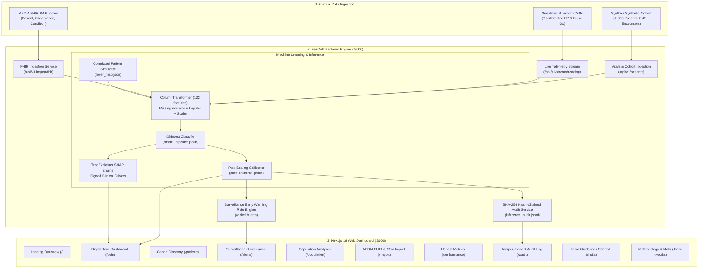

# Pramana Clinical Twin (TwinCare) — Complete System & User Guide

> **Longitudinal Clinical Digital Twin for 365-Day Hypertension Decompensation Risk**  
> Built for the **Happiest Health "Reimagining and Reforming Healthcare in India Summit 2026"**, Bengaluru  
> *Theme: Digital Twin in Healthcare*

[](https://fastapi.tiangolo.com)
[](https://nextjs.org)
[](https://threejs.org)
[](https://xgboost.readthedocs.io)
[](https://python.org)
[](https://typescriptlang.org)
[-brightgreen?style=flat)](backend/tests/test_api.py)

---

## Table of Contents
1. [What Does Our Website & Platform Do?](#1-what-does-our-website--platform-do)
2. [How Does the Website Work? (System Architecture)](#2-how-does-the-website-work-system-architecture)
3. [Quick Start: How to Run the Website](#3-quick-start-how-to-run-the-website)
4. [How to Operate the Website (Step-by-Step Navigation)](#4-how-to-operate-the-website-step-by-step-navigation)
   - [4.1 Dashboard Overview (`/`)](#41-dashboard-overview-)
   - [4.2 The Core Digital Twin (`/twin`)](#42-the-core-digital-twin-twin)
   - [4.3 Cohort Directory (`/patients`)](#43-cohort-directory-patients)
   - [4.4 Surveillance & Early Warning Alerts (`/alerts`)](#44-surveillance--early-warning-alerts-alerts)
   - [4.5 Population Risk Distribution (`/population`)](#45-population-risk-distribution-population)
   - [4.6 ABDM FHIR & Device Import (`/import`)](#46-abdm-fhir--device-import-import)
   - [4.7 Honest Metrics & Model Evaluation (`/performance`)](#47-honest-metrics--model-evaluation-performance)
   - [4.8 Tamper-Evident Audit Log (`/audit`)](#48-tamper-evident-audit-log-audit)
   - [4.9 India Clinical Context (`/india`)](#49-india-clinical-context-india)
   - [4.10 Methodology & Formulas (`/how-it-works`)](#410-methodology--formulas-how-it-works)
5. [How to Read the Data in Detail (Clinical & Statistical Guide)](#5-how-to-read-the-data-in-detail-clinical--statistical-guide)
   - [5.1 Calibrated Risk vs. Raw Score](#51-calibrated-risk-vs-raw-score)
   - [5.2 Understanding 95% Confidence Intervals](#52-understanding-95-confidence-intervals)
   - [5.3 Risk Tiers & Clinical Meaning](#53-risk-tiers--clinical-meaning)
   - [5.4 Interpreting SHAP Clinical Drivers](#54-interpreting-shap-clinical-drivers)
   - [5.5 Interpreting Longitudinal BP & Sparklines](#55-interpreting-longitudinal-bp--sparklines)
   - [5.6 The 3D Physiological Vascular Core](#56-the-3d-physiological-vascular-core)
   - [5.7 Risk Replay Scrubber & Lead Time Days](#57-risk-replay-scrubber--lead-time-days)
   - [5.8 Patient Simulator & Correlated Levers](#58-patient-simulator--correlated-levers)
   - [5.9 Interpreting Live Telemetry & Device Flags](#59-interpreting-live-telemetry--device-flags)
   - [5.10 Cryptographic Audit Trail & SHA-256 Hashes](#510-cryptographic-audit-trail--sha-256-hashes)
6. [Complete API Reference](#6-complete-api-reference)
7. [Validation Truth & Operational Policy](#7-validation-truth--operational-policy)
8. [Ethical Guardrails & Disclaimer](#8-ethical-guardrails--disclaimer)

---

## 1. What Does Our Website & Platform Do?

In India, **over 220 million adults** suffer from hypertension ([ICMR-INDIAB Lancet Study, 2023](https://doi.org/10.1016/S2213-8587(23)00119-5)), but fewer than 15% have their blood pressure under control. Conventional hospital systems and Electronic Health Records (EHRs) operate as static filing cabinets: they record a hypertensive crisis or stroke **after** irreversible cardiovascular damage has occurred.

**Pramana Twin** (*Pramāṇa*, Sanskrit for *evidence, valid cognition, proof*) is a dynamic, longitudinal **Clinical Digital Twin** for cardiovascular care that shifts healthcare from reactive episodic crisis response to proactive, 365-day continuous prevention:

1. **Synthesizes Longitudinal Patient State**: Instead of looking at a single blood pressure number in isolation, it maintains a continuous computational model (digital twin) integrating rolling 365-day vitals trajectories, variability, slopes, lab measurements, comorbidities, and medications across 132 features.
2. **Forecasts 365-Day Acute Decompensation**: Predicts whether a patient will experience blood pressure decompensation (progression to Stage 2 hypertension: $\ge 140$ mmHg systolic / $\ge 90$ mmHg diastolic, or an acute hypertensive event) within the subsequent 12 months.
3. **Calibrates Risks with Empirical Confidence**: Uses Platt scaling calibrators to transform raw machine scores into calibrated probabilities accompanied by 95% confidence intervals, preventing clinical overconfidence.
4. **Explains Every Prediction (SHAP Explainability)**: Leverages TreeExplainer SHAP values to attribute patient-specific risk to tangible clinical drivers (e.g. rising systolic trend, high pulse pressure, missed medication) with positive/negative signed attribution.
5. **Provides a Full Patient Simulator (What-If Lab)**: Allows clinicians to test interventions (e.g. "What if the patient lowers SBP by 10 mmHg and loses 5% weight?") using a correlated lever map (`lever_map.json`) so related features (means, min, max, pulse pressure, BMI) shift together realistically.
6. **Integrates Simulated Live Telemetry**: Connects with Bluetooth oscillometric BP monitors and pulse oximeters, applying 7-day rolling statistics and clinical alert rules in real time.
7. **Empowers Patients Across Languages**: Features a dedicated, jargon-free **Patient View** translated into **English, Hindi (हिंदी), and Kannada (ಕನ್ನಡ)** with recommended questions for their physician.
8. **Ensures Cryptographic Accountability**: Records every model prediction and manual intervention into an append-only, SHA-256 hash-chained audit log that can be verified for tampering at any time.

---

## 2. How Does the Website Work? (System Architecture)



### End-to-End Execution Flow:
1. **User Action / Ingestion**: When you open a patient or submit a new reading, the Next.js frontend calls the FastAPI backend endpoints via `lib/api.ts`.
2. **Feature Harmonization**: `PatientService` extracts or updates 132 longitudinal features, applying temporal lookback windows (the previous 365 days) and preventing target leakage.
3. **ML Inference Pipeline**: Features flow through `ColumnTransformer` (handling missing indicators, imputation, scaling, and one-hot encodings) into the `XGBoostClassifier`.
4. **Probability Calibration**: The raw logit is calibrated via the fitted Platt scaling logistic function:
   $$\hat{P}(Y=1) = \frac{1}{1 + \exp(-(A \cdot \text{logit} + B))}$$
5. **SHAP Factor Attribution**: The tree structure is parsed by `SHAPService` to extract the top positive (risk-increasing) and negative (protective) clinical drivers.
6. **State Broadcast & Rendering**: The frontend updates the interactive 3D vascular model, gauges, trajectory charts, and audit trail in real time.

---

## 3. Quick Start: How to Run the Website

### Prerequisites
- **Python**: Version 3.13 or 3.14 installed
- **Node.js**: Version 18+ (Node 20 or 24 recommended) with `npm`

### Step 1: Install Dependencies
```bash
# 1. Install Backend Python requirements
pip install -r backend/requirements.txt
pip install shap xgboost

# 2. Install Frontend Node packages
cd frontend
npm install
cd ..
```

### Step 2: Launch Backend and Frontend
Open two separate terminal windows (PowerShell or Bash):

**Terminal 1 — Backend API (FastAPI):**
```bash
cd backend
python -m uvicorn app.main:app --host 127.0.0.1 --port 8000 --reload
```
*Backend will be running at:* **[http://127.0.0.1:8000](http://127.0.0.1:8000)**  
*Interactive Swagger API Docs:* **[http://127.0.0.1:8000/docs](http://127.0.0.1:8000/docs)**

**Terminal 2 — Frontend App (Next.js):**
```bash
cd frontend
npm run dev
```
*Frontend will be running at:* **[http://localhost:3000](http://localhost:3000)**

### Step 3: Run the Automated Test Suite (Optional Verification)
```bash
python -m pytest backend/tests/test_api.py -v
```
*Expect: 26/26 tests passing (100%).*

---

## 4. How to Operate the Website (Step-by-Step Navigation)

### 4.1 Dashboard Overview (`/`)
- **Route**: `http://localhost:3000/`
- **What it displays**: Executive summary, Summit theme context (Happiest Health India Summit 2026), digital twin architecture cards, and quick navigation buttons.
- **How to operate**:
  - Click **"Launch Digital Twin"** to enter the core patient twin interface.
  - Click **"Browse Cohort"** to view the patient directory table.
  - Click **"Surveillance & Alerts"** to check active high-risk early warning flags.

---

### 4.2 The Core Digital Twin (`/twin`)
- **Route**: `http://localhost:3000/twin` (or with a specific patient: `http://localhost:3000/twin?patient=PT-101`)
- **Key Sections on this Page**:

#### 1. Patient Selector & Header Bar
- Click the **Patient Dropdown** at the top left to switch between demo synthetic patients (e.g. `PT-101 Elena Rostova`, `PT-102 James Wilson`) or any newly registered patients.
- Click **"Add Reading"** (top right) to open the manual reading dialog:
  - Enter Systolic BP, Diastolic BP, Heart Rate, Weight, Fasting Glucose, and HbA1c.
  - Click **"Save Reading"**: the twin recalculates calibrated risk, appends a new snapshot, shifts the sparkline, and cryptographically signs the event in the audit trail.
- Click **"Print Report"** to generate an immediate, clean 1-page clinical summary PDF.

#### 2. Clinician View vs. Patient View Toggle
- **Clinician View (Default)**: Contains detailed physiological telemetry, 3D pulsing vascular core, Platt-calibrated risk gauge with 95% confidence intervals, and TreeExplainer SHAP attributions.
- **Patient View**: Switches to plain-language communication without AI/ML jargon:
  - Displays summary text like: *"Your blood pressure readings have been gradually rising over the last 3 months."*
  - **Language Selector**: Choose **English**, **हिंदी (Hindi)**, or **ಕನ್ನಡ (Kannada)**.
  - Shows 3 recommended, non-diagnostic questions for the patient to ask their doctor at their next primary health center (PHC) visit.

#### 3. 3D Spatial Physiological Core (Three.js)
- Displays an interactive 3D pulsing vascular heart/aortic core in real time.
- **Rotation**: Click and drag with your mouse to rotate the 3D model.
- **Zoom**: Scroll your mouse wheel to zoom in and out.
- **Visual Feedback**: The pulsing frequency corresponds to the patient's heart rate; the glowing shader color shifts from cyan/blue (optimal/low risk) to amber (moderate) and vibrant crimson/red (high risk).

#### 4. Platt-Calibrated Risk Gauge
- Visualizes the patient's 365-day decompensation risk as a calibrated percentage.
- Shows the **95% Confidence Interval** (e.g. `[41.2%, 55.4%]`) beneath the gauge.
- Displays the clinical risk badge: **Low Tier (< 15%)**, **Moderate Tier (15%–35%)**, or **High Tier (> 35%)**.

#### 5. Signed SHAP Clinical Drivers
- Breaks down the primary reasons why the AI model assigned this risk level.
- **Red (+) Bars**: Features that increase decompensation risk (e.g. High 365-day Mean Systolic BP, High BMI, Positive SBP Slope).
- **Green (-) Bars**: Protective features that decrease risk (e.g. Stable Heart Rate, Normal Blood Pressure Range, Controlled Fasting Glucose).

#### 6. Risk Replay Scrubber (Historical Trajectory)
- Located below the main vitals cards.
- Allows scrubbing through historical snapshots across the past 365 days.
- **Play Button (▶)**: Automatically animates through the patient's timeline.
- **Slider Bar**: Manually scrub back and forth to inspect past readings.
- **Early Warning Marker (⚠️)**: Highlights the exact snapshot where calibrated risk crossed the surveillance threshold, showing the **Lead Time Days** (e.g. 112 days lead time) prior to clinical decompensation.

#### 7. Full Patient Simulator (What-If Lab Tab)
- Click the **"Patient Simulator"** tab on the twin page.
- **Primary Levers**:
  - **Systolic BP Delta slider**: Adjust from `-30 mmHg` to `+30 mmHg`.
  - **Diastolic BP Delta slider**: Adjust from `-20 mmHg` to `+20 mmHg`.
  - **Heart Rate slider**: Adjust resting heart rate.
  - **Weight Change %**: Test weight loss (e.g. `-5%`) or weight gain.
  - **Fasting Glucose & HbA1c sliders**: Model glycemic control interventions.
  - **Condition Toggles**: Toggle hypertension, diabetes, or CKD status.
- **Correlated Lever Shifting**: Moving any lever automatically updates all correlated columns in `lever_map.json` (means, minimums, maximums, pulse pressure, and BMI).
- **Sensitivity Curves**: Visualizes non-linear step-function response per variable with the patient's current clinical position marked.
- **Presets**: Click one-click clinical presets (*Improve BP Control*, *Weight Loss*, *Worsening Diabetes*, *Missed Medication*, *Salt Reduction*).
- **Side-by-Side Comparison**: Click **"Save Scenario"** (up to 3 scenarios) to compare intervention outcomes side-by-side.

#### 8. Simulated Wearables & Live Telemetry Layer
- Click the **"Live Telemetry"** tab on the twin page.
- Demonstrates integration with low-cost Bluetooth oscillometric cuffs and pulse oximeters.
- Displays 7-day rolling statistics: Mean Resting HR, HR Variability, Mean Home SBP/DBP, BP Variability, and SpO2.
- **Manual Reading Form**: Enter a live home reading and click **"Send Reading"**.
- **Auto-Simulate Readings**: Toggle this switch to have the system emit simulated telemetry readings every 5 seconds.
- Displays clinical safety rules (e.g. Home SBP $\ge 140$ mmHg on $\ge 5$ of 7 days, resting tachycardia, SpO2 dips).

---

### 4.3 Cohort Directory (`/patients`)
- **Route**: `http://localhost:3000/patients`
- **What it displays**: Directory table of all 50 synthetic cohort patients plus any registered patients.
- **How to operate**:
  - **Search Bar**: Type any name or patient ID to filter instantly.
  - **Risk Tier Filter**: Click **All**, **High Risk**, **Moderate Risk**, or **Low Risk**.
  - **Demographic Filters**: Filter by Age band (`<40`, `40-49`, `50-59`, `60-69`, `70+`) and Gender.
  - **Sparklines**: Hover over the systolic BP sparkline to view historical reading trends.
  - **Action**: Click **"Open Twin"** on any row to load that patient's full digital twin.
  - **Register Patient**: Click **"+ Register Synthetic Patient"** to create a custom patient with baseline vitals, conditions, and medications.

---

### 4.4 Surveillance & Early Warning Alerts (`/alerts`)
- **Route**: `http://localhost:3000/alerts`
- **What it displays**: Cohort-wide early warning surveillance monitoring patients whose risk trajectories are rising.
- **How to operate**:
  - Adjust the **Snapshot Lookback Window ($N = 2–10$)** slider to evaluate trajectory drift over varying clinical horizons.
  - Adjust the **Risk-Rise Threshold** slider to filter by rate of risk acceleration.
  - Review the list of flagged patients, their lead time days before acute decompensation, and recommended proactive outreach actions.

---

### 4.5 Population Risk Distribution (`/population`)
- **Route**: `http://localhost:3000/population`
- **What it displays**: Macro-level cohort analytics across the entire patient population.
- **How to operate**:
  - View calibrated risk histograms and density curves.
  - Inspect risk tier distributions stratified by age band, gender, and comorbidity clusters.
  - Evaluate health system resource allocation and population health budgeting.

---

### 4.6 ABDM FHIR & Device Import (`/import`)
- **Route**: `http://localhost:3000/import`
- **What it displays**: Dual ingestion pathways: ABDM-aligned FHIR R4 Bundles and peripheral device CSV feeds.
- **How to operate**:
  - **FHIR Bundle Import**: Paste ABDM FHIR R4 JSON bundles containing `Patient`, `Observation` (LOINC codes `8480-6`, `8462-4`, `8867-4`), `Condition`, and `MedicationStatement` resources. Click **"Validate & Ingest"** to parse and register the patient.
  - **Peripheral Device CSV Upload**: Upload or paste CSV telemetry logs from low-cost Bluetooth oscillometric BP monitors and fingertip pulse oximeters.

---

### 4.7 Honest Metrics & Model Evaluation (`/performance`)
- **Route**: `http://localhost:3000/performance`
- **What it displays**: Radical honesty in healthcare AI: real-world evaluation metrics, calibration reliability curves, and alert budget policies.
- **How to operate**:
  - Inspect the **Reliability Diagram**: compares uncalibrated raw scores against Platt-calibrated empirical probabilities.
  - Read the **Alert-Budget Operational Policy Table**: explains why a static theoretical cutoff (0.7562) missed all positives, and how operational alert budgets (top 5%, 10%, 20%) provide 42.9%–64.3% sensitivity.
  - View confusion matrices, test ROC-AUC (0.8069), PR-AUC (0.0644), and 95% confidence intervals.

---

### 4.8 Tamper-Evident Audit Log (`/audit`)
- **Route**: `http://localhost:3000/audit`
- **What it displays**: Append-only, cryptographic SHA-256 hash-chain logging every model inference, what-if simulation, and manual vitals modification.
- **How to operate**:
  - Inspect individual audit blocks displaying timestamps, model versions, input hashes, calibrated risk, and chained cryptographic hashes.
  - Click **"Verify Log Integrity"**: walks the entire hash chain from the genesis block (`0000...0000`) to the latest entry, confirming zero tampering.

---

### 4.9 India Clinical Context (`/india`)
- **Route**: `http://localhost:3000/india`
- **What it displays**: Epidemiological framing and alignment with the Indian healthcare ecosystem:
  - ICMR-INDIAB Lancet 2023 statistics (220M hypertensive citizens).
  - Indian Guidelines on Hypertension (IGH-IV / ICMR, 140/90 mmHg reference thresholds).
  - Ayushman Bharat Digital Mission (ABDM) integration roadmap and Ayushman Arogya Mandir (AAM) deployment readiness.

---

### 4.10 Methodology & Formulas (`/how-it-works`)
- **Route**: `http://localhost:3000/how-it-works`
- **What it displays**: In-depth mathematical and engineering documentation:
  - 132-feature extraction pipeline breakdown.
  - Platt scaling logistic calibration formulas.
  - TreeExplainer SHAP game-theoretic attribution mechanics.
  - Correlated counterfactual simulation formulas and lever mapping.

---

## 5. How to Read the Data in Detail (Clinical & Statistical Guide)

### 5.1 Calibrated Risk vs. Raw Score

| Term | What It Is | How to Read It | Clinical Meaning |
| :--- | :--- | :--- | :--- |
| **Raw Score** | Raw uncalibrated output from the XGBoost ensemble ($0.0000$ to $1.0000$). | **Do NOT interpret as probability.** Tree models output distorted probability ranks, especially in imbalanced datasets. | Useful solely for ranking patients from highest to lowest relative risk. |
| **Calibrated Risk** | Probability adjusted via empirical Platt scaling: $\hat{P} = \frac{1}{1 + e^{-(A \cdot \text{logit} + B)}}$. | **Read as the actual statistical likelihood** that this patient will experience blood pressure decompensation within 365 days. | Direct probability to guide clinical follow-up frequency and intervention urgency. |

---

### 5.2 Understanding 95% Confidence Intervals
Beneath the calibrated risk gauge, you will see a range such as **`[41.2%, 55.4%]`**:
- **Why it matters**: Point estimates can deceive. A single number like `48.2%` hides statistical uncertainty.
- **How to interpret**: There is a 95% empirical confidence that the true underlying decompensation risk falls between `41.2%` and `55.4%`.
- **Wide intervals** indicate greater clinical uncertainty (e.g. fewer historical readings or high measurement variance).
- **Narrow intervals** indicate high certainty backed by extensive longitudinal records.

---

### 5.3 Risk Tiers & Clinical Meaning

| Risk Tier | Calibrated Risk Range | Color Badge | Recommended Clinical Action |
| :--- | :--- | :--- | :--- |
| **Low Risk** | **$0.0\% - 14.9\%$** | 🟢 **Green** | Standard annual wellness check; maintain healthy lifestyle, dietary sodium moderation, and physical activity. |
| **Moderate Risk** | **$15.0\% - 34.9\%$** | 🟡 **Amber** | Increased monitoring cadence (e.g. 3-month review); home blood pressure monitoring (HBPM); review sodium and medication adherence. |
| **High Risk** | **$\ge 35.0\%$** | 🔴 **Red** | Urgent clinical review; evaluate anti-hypertensive medication regimen; initiate tele-surveillance and lifestyle coaching; evaluate target organ damage. |

---

### 5.4 Interpreting SHAP Clinical Drivers
The SHAP (SHapley Additive exPlanations) factors translate complex multi-tree decisions into plain clinical factors:
- **Red (+ Value, Bar to the Right)**: This specific variable **pushed the patient's risk higher**.
  - *Example*: `+0.14 Systolic BP (365d Mean)` means the patient's high rolling average systolic pressure added 14 percentage points to their risk score.
  - *Example*: `+0.09 Systolic Slope (Accelerating)` means an upward trend over the past months is compounding cardiovascular risk.
- **Green (- Value, Bar to the Left)**: This variable was **protective and lowered the patient's risk**.
  - *Example*: `-0.08 Fasting Glucose (Controlled)` means optimal metabolic control is mitigating microvascular risk.

---

### 5.5 Interpreting Longitudinal BP & Sparklines
- **Latest Systolic / Diastolic (e.g. 142 / 88 mmHg)**: The most recent clinical measurement.
- **Pulse Pressure (SBP - DBP, e.g. 54 mmHg)**: Represents arterial stiffness. A pulse pressure $> 60$ mmHg is an independent marker of vascular aging and cardiovascular risk.
- **365-Day Rolling Mean**: Dampens acute white-coat spikes to reveal the true chronic hemodynamic load.
- **365-Day Min / Max Range**: Highlights blood pressure volatility. Extreme fluctuations ($\text{SD} > 12$ mmHg) signify autonomic dysregulation.
- **Slope (mmHg / year)**: Positive slope ($> 0$) indicates gradual decompensation even if the single latest reading seems borderline.

---

### 5.6 The 3D Physiological Vascular Core
The Three.js visualizer represents the patient's cardiovascular system:
- **Pulsing Speed**: Dynamically synchronizes with the patient's resting heart rate (bpm).
- **Core Illumination**:
  - **Cyan / Blue Core**: Stable hemodynamics, Low Risk tier.
  - **Golden / Amber Core**: Borderline hypertension, Moderate Risk tier.
  - **Pulsing Crimson Core**: High arterial stress, High Risk tier, or active Stage 2 decompensation.

---

### 5.7 Risk Replay Scrubber & Lead Time Days
When you scrub through a patient's historical snapshots:
- Observe the **trajectory drift**: watch the risk tier transition from Low to Moderate to High over months.
- When the timeline hits the **Early Warning Marker (⚠️)**, note the **Lead Time Days** (e.g. `112 days lead time`):
  - This indicates the system detected actionable trajectory deterioration **112 days before** the patient presented with acute clinical decompensation.

---

### 5.8 Patient Simulator & Correlated Levers
When testing what-if interventions:
- **Baseline Risk**: The patient's actual calibrated risk today.
- **Simulated Risk**: The projected risk if the simulated levers are achieved.
- **Delta ($\Delta$ pp)**: The difference in percentage points (e.g. `-12.4 pp` reduction).
- **Correlated Changes List**: Verifies that moving SBP by `-15 mmHg` also shifted `sbp_mean_365d`, `sbp_max_365d`, `sbp_last_365d`, and `pulse_pressure_latest`.
- **Distribution Guardrails**:
  - `OUT_OF_RANGE`: Warning triggered if an entered value falls outside the biological training distribution.
  - `LOW_SENSITIVITY`: Warning triggered if an adjustment falls within a flat decision-tree step plateau.

---

### 5.9 Interpreting Live Telemetry & Device Flags
- **Home BP Mean ($\ge 140$ mmHg)**: Flagged if home SBP is $\ge 140$ mmHg on 5 or more out of 7 days, indicating true sustained out-of-office hypertension.
- **Resting Tachycardia**: Flagged if mean resting heart rate exceeds 100 bpm.
- **Excessive BP Variability**: Flagged if 7-day standard deviation exceeds 12 mmHg.
- **Nocturnal SpO2 Dips**: Flagged if nocturnal pulse oximetry falls below 93%, indicating possible obstructive sleep apnea (a frequent secondary driver of resistant hypertension).

---

### 5.10 Cryptographic Audit Trail & SHA-256 Hashes
Every record in `/audit` contains:
- `entry_index`: Incremental block sequence number (0, 1, 2, ...).
- `prev_hash`: The SHA-256 hash of the preceding block (entry 0 links to genesis `0*64`).
- `current_hash`: The SHA-256 hash of:
  $$\text{SHA256}(\text{prev\_hash} \parallel \text{timestamp} \parallel \text{model\_version} \parallel \text{fingerprint} \parallel \text{input\_hash} \parallel \text{score} \parallel \text{calibrated\_risk} \parallel \text{tier} \parallel \text{context})$$
- Clicking **"Verify Log Integrity"** performs an automated cryptographic walk to confirm that not a single byte has been altered post-inference.

---

## 6. Complete API Reference

| Method | Endpoint | Description |
| :--- | :--- | :--- |
| `GET` | `/api/v1/health` | Backend status, model version (`1.0.0`), and schema fingerprint (`a4ddaedbdbc8bb07`). |
| `GET` | `/api/v1/model/info` | Model metadata, AUC metrics, and Platt calibrator parameters. |
| `GET` | `/api/v1/model/performance` | Calibration reliability curves and alert-budget policy tables. |
| `GET` | `/api/v1/patients` | Paginated cohort table with vitals sparklines and risk tiers. |
| `GET` | `/api/v1/patients/{id}` | Full patient digital twin state: demographics, vitals, snapshots, and conditions. |
| `POST` | `/api/v1/patients/register` | Register a new synthetic patient with baseline vitals and comorbidities. |
| `POST` | `/api/v1/patients/{id}/readings` | Ingest a new blood pressure reading, recalculate calibrated risk, and append snapshot. |
| `DELETE`| `/api/v1/patients/{id}` | Delete a registered patient record (demo patients protected). |
| `POST` | `/api/v1/predict` | Run model inference: returns raw score, calibrated risk, 95% CI, and SHAP factors. |
| `POST` | `/api/v1/simulate` | Full patient simulator shifting correlated features via `lever_map.json`. |
| `GET` | `/api/v1/patients/{id}/sensitivity` | Multi-point sensitivity step-function curves across primary vitals. |
| `GET` | `/api/v1/patients/{id}/timeline-risk` | Historical snapshots for risk replay scrubber. |
| `GET` | `/api/v1/alerts` | Surveillance engine filtering patients with rising risk trajectories. |
| `POST` | `/api/v1/stream/reading` | Ingest live telemetry reading and broadcast via Server-Sent Events (SSE). |
| `GET` | `/api/v1/stream/{patient_id}` | Live SSE telemetry stream connection. |
| `POST` | `/api/v1/patients/import-fhir` | Ingest ABDM FHIR R4 Bundle JSON with mapping report and validation. |
| `GET` | `/api/v1/audit` | Retrieve append-only inference audit log entries. |
| `GET` | `/api/v1/audit/verify` | Cryptographic SHA-256 hash-chain integrity verification. |

---

## 7. Validation Truth & Operational Policy

### Baseline Performance Metrics
The model operates on a rolling 365-day observation window to predict decompensation within the next 365 days:
- **Cohort Size**: 1,335 Synthea synthetic patients (6,451 longitudinal encounter rows).
- **Test Set**: 964 patients with **14 true positive events** (base rate = **1.457%**).
- **Test ROC-AUC**: **0.8069** [95% CI: 0.691, 0.908].
- **Test PR-AUC**: **0.0644** (representing a **4.4x statistical enrichment** over the 0.0146 baseline).

### Alert-Budget Operational Policy Table (N = 964 Test Patients)
Because an arbitrary theoretical cutoff of `0.7562` captured zero test positives (0% recall), health system deployments should adopt an **Alert-Budget Operating Policy**:

| Surveillance Policy | Alert Cutoff | True Positives | False Positives | Precision (PPV) [95% CI] | Recall (Sensitivity) [95% CI] |
| :--- | :--- | :--- | :--- | :--- | :--- |
| **Top 5% Alert Budget** | `0.4577` | 4 | 44 | 8.3% `[2.7%, 19.9%]` | **28.6%** `[10.8%, 55.1%]` |
| **Top 10% Alert Budget** | `0.3003` | 6 | 90 | 6.2% `[2.6%, 13.0%]` | **42.9%** `[20.0%, 68.3%]` |
| **Top 20% Alert Budget** | `0.1802` | 9 | 184 | 4.7% `[2.3%, 8.6%]` | **64.3%** `[38.8%, 83.7%]` |

---

## 8. Ethical Guardrails & Disclaimer

1. **Synthetic Data Benchmark**: Pramana Twin is trained strictly on synthetic EHR data generated via Synthea. It is **not validated for clinical diagnosis, prescribing, or autonomous treatment decisions**.
2. **India Population Generalizability**: While aligned with ICMR-INDIAB epidemiology and IGH-IV guidelines, this prototype has not yet been validated on Indian clinical cohorts, which exhibit distinct visceral adiposity phenotypes, dietary sodium variations, and earlier onset of vascular disease.
3. **Software as a Medical Device (SaMD) Notice**: This system is a research demonstration prototype. In real clinical environments, digital twins must operate under licensed physician oversight in compliance with India's CDSCO Medical Device Rules and the Digital Personal Data Protection (DPDP) Act 2023.
