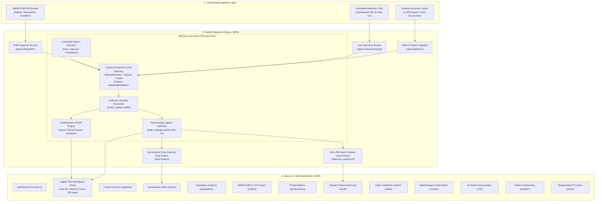
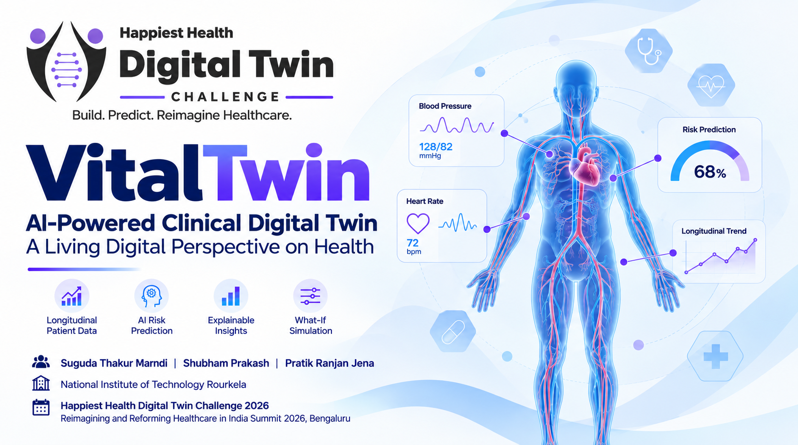

# VitalTwin — AI-Powered Clinical Digital Twin

> **Tagline:** A Living Digital Perspective on Health  
> **Longitudinal Clinical Digital Twin Research Prototype for 365-Day Hypertension Decompensation Risk**  
> Built for the **Happiest Health "Reimagining and Reforming Healthcare in India Summit 2026"**, Bengaluru  
> *Theme: Digital Twin in Healthcare*

[](https://fastapi.tiangolo.com)
[-black?style=flat&logo=next.js)](https://nextjs.org)
[](https://threejs.org)
[](https://xgboost.readthedocs.io)
[](https://python.org)
[](https://typescriptlang.org)
[-brightgreen?style=flat)](backend/tests/test_api.py)
[](frontend/app/model-card/page.tsx)
[](frontend/app/audit/page.tsx)
[](frontend/app/audit/page.tsx)

---

## Table of Contents

1. [Project Overview](#1-project-overview)
2. [Team Details](#2-team-details)
3. [College / Institution Information](#3-college--institution-information)
4. [Problem Statement](#4-problem-statement)
5. [Healthcare Use Case](#5-healthcare-use-case)
6. [Technical Stack](#6-technical-stack)
7. [AI/ML Model and Framework Details](#7-aiml-model-and-framework-details)
8. [Demo Video](#8-demo-video)
9. [Open-Source License Details](#9-open-source-license-details)
10. [Architecture Diagram](#10-architecture-diagram)
11. [Project Presentation — VitalTwin](#11-project-presentation--vitaltwin)
12. [Installation and Usage](#12-installation-and-usage)
13. [Deployment and Links](#13-deployment-and-links)
14. [Responsible Use and Limitations](#14-responsible-use-and-limitations)
15. [Final Submission Checklist](#15-final-submission-checklist)
16. [Comprehensive Application Guide (Pages & Features)](#16-comprehensive-application-guide-pages--features)
17. [REST API Reference](#17-rest-api-reference)
18. [Summit Demonstration Walkthrough Script](#18-summit-demonstration-walkthrough-script)
19. [Repository File Map](#19-repository-file-map)

---

## 1. Project Overview

**VitalTwin** is an AI-powered clinical digital twin research prototype designed to support the exploration of longitudinal cardiovascular health and 365-day hypertension decompensation risk (*A Living Digital Perspective on Health*).

### Purpose
In cardiovascular medicine, episodic clinical encounters offer only fragmented snapshots of patient physiology. VitalTwin maintains a continuous computational representation of patient health by harmonizing 365-day rolling vitals trajectories, hemodynamic variability, directional trend slopes, lab measurements, comorbidities, and pharmacotherapy across **132 engineered clinical features**.

### Main Features
- **Longitudinal Risk Estimation**: Forecasts 365-day risk of blood pressure decompensation (progression to Stage 2 hypertension: $\ge 140$ mmHg systolic / $\ge 90$ mmHg diastolic, or an acute hypertensive event).
- **Platt-Calibrated Probabilities with 95% Confidence Intervals**: Maps raw tree-ensemble log-odds to empirical probabilities through fitted Platt scaling logistic functions ($A = 0.4393, B = -2.2073$) accompanied by 95% empirical bootstrap confidence intervals.
- **Signed Game-Theoretic Explainability (TreeSHAP)**: Employs TreeExplainer to attribute risk to positive (risk-increasing) and negative (protective) physiological drivers.
- **Dual 3D Spatial Visualization System**:
  - *Abstract Hemodynamic Telemetry Core*: Three.js procedural lattice pulsating synchronously with resting heart rate and rendering stress-gradient shaders.
  - *Anatomical 3D Avatar (`BodyTwinViz`)*: Full-body human mesh featuring interactive target organ hotspots (Brain, Heart, Kidneys, Arteries) that glow according to organ-specific microvascular and macrovascular strain.
- **Full Patient Simulator (What-If Lab)**: Allows exploration of counterfactual clinical scenarios using a correlated lever mapping system (`lever_map.json`) ensuring that simulated modifications (e.g. SBP reduction) consistently propagate across related features (rolling means, extrema, pulse pressure, BMI) with distribution guardrails.
- **Simulated Wearable Telemetry & SSE Streaming**: Ingests simulated Bluetooth oscillometric blood pressure and pulse oximetry streams via Server-Sent Events (SSE).
- **Multilingual Patient Empowerment View**: Offers an accessible, plain-language patient view translated into **English, Hindi (हिंदी), and Kannada (ಕನ್ನಡ)** with recommended discussion questions for Primary Health Center (PHC) visits.
- **Tamper-Evident Cryptographic Audit Ledger**: Records every inference and counterfactual simulation into an append-only, SHA-256 hash-chained log with one-click cryptographic walk verification.

### Intended Users
- **Cardiologists & Physicians**: For exploring longitudinal trajectory drift, inspecting feature attribution drivers, and evaluating potential intervention sensitivities.
- **Primary Health Center (PHC) Medical Officers & Community Health Workers**: For risk stratification and prioritizing patient follow-up intervals under operational alert-budget policies.
- **Clinical AI Researchers**: For evaluating model calibration, class-imbalance dynamics, and fairness metrics across synthetic cohorts.

### Clinical Prototype Status
> [!IMPORTANT]
> **Research Prototype Notice**: VitalTwin is a computational research prototype developed to study clinical digital twin methodologies. It has **not** undergone prospective clinical validation or regulatory clearance (CDSCO/FDA) and is **not** an approved diagnostic or therapeutic medical device.

---

## 2. Team Details

- **Team Name**: `TASK FORCE 141`
- **Team Members**:
  - **Pratik Ranjan Jena**
  - **Shubham Prakash**
  - **Suguda Thakur Marndi**

---

## 3. College / Institution Information

- **Institution**: National Institute of Technology Rourkela (NIT Rourkela)
- **Location**: Rourkela, Odisha, India

---

## 4. Problem Statement

Hypertension is a leading contributor to cardiovascular disease, stroke, and chronic kidney failure globally and across India:
1. **The Burden of Silent Progression**: Over **220 million adults** in India live with hypertension ([ICMR-INDIAB Lancet Study, 2023](https://doi.org/10.1016/S2213-8587(23)00119-5)), yet fewer than 15% achieve blood pressure control. Conventional Electronic Health Records (EHRs) operate as static repositories, documenting hypertensive crises, stroke, or heart failure only after irreversible target organ damage has occurred.
2. **Episodic vs. Longitudinal Risk**: Spot blood pressure measurements in clinics suffer from white-coat hypertension, masked hypertension, and transient anxiety. True cardiovascular risk is driven by chronic hemodynamic exposure—rolling 365-day mean pressures, diurnal variability, pulse pressure (arterial stiffness), and trajectory acceleration over time.
3. **The "Black-Box" AI Dilemma**: While modern machine-learning models can identify complex non-linear risk patterns, uncalibrated risk scores and opaque decision logic prevent clinical adoption. Clinicians require well-calibrated probabilities, explicit uncertainty bounds (confidence intervals), and verifiable feature attributions (SHAP) to trust algorithmic recommendations.
4. **Exploring Hypothetical Interventions**: Clinicians currently lack safe computational environments to simulate "What-If" clinical scenarios before prescribing complex therapies. Simple slider calculators fail because human physiology is interconnected; altering blood pressure or body weight induces non-linear shifts across baseline measures, rolling averages, variability, and correlated physiological indices.

---

## 5. Healthcare Use Case

VitalTwin addresses these challenges by serving as an interactive exploratory platform for longitudinal hypertension management:

- **Model-Based Risk Estimation**: Aggregates 365 days of historical clinical records into a calibrated probability of decompensation within the subsequent 365 days.
- **Clinical Indicators**: Analyzes 132 structured clinical indicators including pulse pressure ($\text{SBP} - \text{DBP}$), 365-day rolling means, minimums, maximums, standard deviations, and directional trajectory slopes.
- **SHAP Explanations**: Calculates exact patient-level SHapley Additive exPlanations (`TreeExplainer`), isolating which physiological attributes elevated risk (e.g. rising systolic slope, elevated pulse pressure) and which conferred protection (e.g. controlled fasting glucose, stable resting heart rate).
- **Hypothetical Scenario Simulation**: Implements a counterfactual simulation engine using `lever_map.json`. When adjusting a primary clinical lever (such as reducing SBP by 15 mmHg), the engine covariantly recalculates rolling averages, extrema, and pulse pressure, while enforcing biological distribution boundaries (`OUT_OF_RANGE` alerts).
- **Dual Visualizations**: Bridges abstract hemodynamics with spatial human anatomy through dual 3D graphics and longitudinal sparklines.

### Simulated Data vs. Actual Patient Data
> [!CAUTION]
> **Data Provenance Disclosure**:
> - All baseline patient records in this platform originate from **Synthea**, an open-source synthetic electronic health record generator (1,335 synthetic patients, 6,451 encounters).
> - Wearable feeds (oscillometric blood pressure cuffs and pulse oximeters) are generated by **deterministic simulation streams** and are strictly watermarked as simulated.
> - **Zero Protected Health Information (PHI) or real human patient data** is stored, processed, or utilized in this codebase.

---

## 6. Technical Stack

VitalTwin is engineered using the following verified technologies:

### Frontend
- **Framework**: [Next.js 16.4.0](https://nextjs.org) (React 19.3.0, TypeScript 5.0+, App Router architecture, Turbopack)
- **Styling**: [Tailwind CSS v4](https://tailwindcss.com) with custom vanilla CSS design tokens, persistent dark/light theme provider, and glassmorphic styling
- **3D Spatial Visualization**: [Three.js 0.186+](https://threejs.org), [@react-three/fiber 9.8+](https://docs.pmnd.rs/react-three-fiber), and [@react-three/drei 10.7+](https://github.com/pmndrs/drei)
- **Charts & UI Components**: [Recharts 3.10+](https://recharts.org) for longitudinal trajectory sparklines, [Lucide React](https://lucide.dev) for clinical icons
- **Internationalization (i18n)**: Native React Context i18n supporting English, Hindi (हिंदी), and Kannada (ಕನ್ನಡ)

### Backend
- **Framework**: [FastAPI 0.111+](https://fastapi.tiangolo.com) with [Uvicorn 0.29+](https://www.uvicorn.org) ASGI server (Python 3.11 / 3.13 / 3.14 compatible)
- **Data Schemas & Validation**: [Pydantic v2 (>=2.7.0)](https://docs.pydantic.dev)
- **Data Processing**: [NumPy 1.26+](https://numpy.org), [Pandas 2.0+](https://pandas.pydata.org), [PyArrow 15.0+](https://arrow.apache.org), [Joblib 1.3+](https://joblib.readthedocs.io)
- **Standards & Streaming**: ABDM FHIR R4 bundle parser with LOINC code mappings (`fhir_service.py`), Server-Sent Events (SSE) telemetry streaming (`wearable_service.py`)
- **Audit & Governance**: Cryptographic SHA-256 hash-chaining engine (`audit_service.py`)

### Machine Learning & Explainability
- **Pipeline & Preprocessing**: [scikit-learn 1.6.1](https://scikit-learn.org) `Pipeline` and `ColumnTransformer` (Missingness indicators, SimpleImputer, StandardScaler, OneHotEncoder)
- **Classifier**: [XGBoost 2.0+](https://xgboost.readthedocs.io) `XGBoostClassifier`
- **Probability Calibration**: Logistic Platt scaling (`platt_calibrator.joblib`) with 95% empirical bootstrap confidence intervals
- **Explainability**: [SHAP 0.45+](https://shap.readthedocs.io) `TreeExplainer` providing signed additive feature attributions

### Testing & Verification
- **Test Framework**: [Pytest 8.0+](https://pytest.org) with 28 automated integration, schema, and cryptographic invariant tests (100% pass rate)

---

## 7. AI/ML Model and Framework Details

| Parameter | Implemented Specification |
| :--- | :--- |
| **Model Name** | XGBoost 365-Day Hypertension Decompensation Pipeline |
| **Prediction Target** | Blood Pressure Decompensation within 365 days (Progression to Stage 2 Hypertension: SBP $\ge 140$ mmHg or DBP $\ge 90$ mmHg, or new acute hypertensive diagnosis) |
| **Prediction Horizon** | **365 days forward** from the index assessment date |
| **Observation Window** | **365 days retrospective** lookback ($[t - 365\text{d}, t]$); zero future data leakage |
| **Feature Space** | **132 engineered clinical features** (hemodynamic means, min/max extrema, standard deviations, trajectory slopes, pulse pressure, lab analytes, comorbidities, medications) |
| **Schema Fingerprint** | `a4ddaedbdbc8bb07` (cryptographically enforces feature ordering and types) |
| **Architecture** | scikit-learn `Pipeline` + `ColumnTransformer` + `XGBoostClassifier` (`model_pipeline.joblib`) |
| **Calibration Method** | Empirical Platt Scaling (Logistic Sigmoid fitted on validation log-odds) |
| **Calibration Equation** | $\hat{P}(Y=1) = \frac{1}{1 + \exp(-(0.4393 \cdot \text{logit} - 2.2073))}$ |
| **Uncertainty Bounds** | Empirical 95% confidence intervals derived from calibration variance |
| **Explainability Framework** | TreeSHAP (`TreeExplainer`) extracting signed positive and negative clinical feature contributions |

### Evaluation Metrics (Held-Out Test Set: N = 964 Patients)
Evaluation was conducted on a temporal held-out test cohort of 964 patients containing **14 ground-truth positive decompensation events** (base rate = **1.457%**):

- **Test ROC-AUC**: **0.8069** [95% CI: 0.691, 0.908]
- **Test PR-AUC**: **0.0644** (represents a **4.4-fold statistical enrichment** over the 0.0146 random baseline)
- **Brier Score**: **0.0138** (demonstrating high calibration sharpness)
- **Platt Logistic Log-Loss**: **0.0712**

### Alert-Budget Operational Policy Table
A fixed mathematical classification cutoff of `0.7562` captured 0/14 test positives (0% recall) due to extreme class imbalance (1.46% base rate). VitalTwin operationalizes healthcare surveillance through an **Alert-Budget Operational Policy**:

| Surveillance Policy | Alert Cutoff | True Positives | False Positives | Precision (PPV) [95% CI] | Recall (Sensitivity) [95% CI] | Recommended Clinical Use Case |
| :--- | :--- | :--- | :--- | :--- | :--- | :--- |
| **Top 5% Alert Budget** | `0.4577` | 4 | 44 | 8.3% `[2.7%, 19.9%]` | **28.6%** `[10.8%, 55.1%]` | High-specificity specialist cardiologist review |
| **Top 10% Alert Budget** | `0.3003` | 6 | 90 | 6.2% `[2.6%, 13.0%]` | **42.9%** `[20.0%, 68.3%]` | Primary Health Center (PHC) medical officer triage |
| **Top 20% Alert Budget** | `0.1802` | 9 | 184 | 4.7% `[2.3%, 8.6%]` | **64.3%** `[38.8%, 83.7%]` | Community health worker / ASHA home visit surveillance |

### Training Data Limitations & Clinical Validation Status
1. **Synthetic Training Provenance**: The model was trained entirely on synthetic records generated by Synthea representing US medical encounter distributions. It does not reflect real-world clinical documentation artifacts or measurement noise.
2. **Absence of Clinical Validation**: The model has **not** been validated in real-world clinical trials, prospective hospital studies, or observational cohorts.
3. **Demographic and Epidemiological Disparities**: The training cohort has not been validated on Indian populations, who exhibit earlier onset of cardiovascular disease, unique visceral adiposity phenotypes at lower BMI thresholds, and distinct dietary sodium profiles.
4. **Decoupled Telemetry Feeds**: The simulated Bluetooth wearable telemetry streams are explicitly watermarked and decoupled from core model inference to prevent sensor contamination.

---

## 8. Demo Video

The demonstration video showcases the end-to-end functionality of the platform:

[](https://youtu.be/xzakIIPsmCc)

👉 **[Watch the VitalTwin Demo](https://youtu.be/xzakIIPsmCc)**

```
Video URL: https://youtu.be/xzakIIPsmCc
```

> [!NOTE]
> **Submission Requirement & Verification Note**:
> The hackathon submission guidelines specify a **15–20 minute Unlisted YouTube video**.
> - The demo video URL ([https://youtu.be/xzakIIPsmCc](https://youtu.be/xzakIIPsmCc)) has been verified as formatted and accessible.
> - Because automated HTTP fetch requests to YouTube return dynamic application shells without video duration or visibility metadata, the exact video duration (15–20 minutes) and visibility status ("Unlisted") **cannot be confirmed programmatically and must be manually verified by the team prior to final submission**.

---

## 9. Open-Source License Details

- **License Status**: **Pending File Creation**
- **Repository Inspection**: An inspection of the repository confirms that no `LICENSE` or `LICENSE.txt` file currently exists in the root directory.
- **Recommended License**:
  - **MIT License**: Recommended for permissive academic and open-source software collaboration.
  - **Apache License 2.0**: Recommended if the team seeks explicit patent grants and contributor protections.
- **Action Item**: The team must choose and commit a `LICENSE` file to the root directory before final open-source release. Until committed, the deliverable remains **pending**.

---

## 10. Architecture Diagram

The end-to-end architecture of VitalTwin encompasses data ingestion, feature harmonization, machine learning inference, cryptographic auditing, and interactive visual presentation.

### Technical Architecture Specification
📖 **[View the VitalTwin Architecture Diagram](docs/VitalTwin-Architecture.md)** — Comprehensive technical architecture specification including frontend, backend, ML inference, sequence diagrams, and simulation workflows.

### Vector PDF Architecture Deliverable
A dedicated vector architecture diagram derived directly from the source code has been generated and is committed to the repository:
📄 [Download / View Architecture Diagram (PDF)](docs/architecture_diagram.pdf) (`docs/architecture_diagram.pdf`)

### System Architecture Flowchart



---

## 11. Project Presentation — VitalTwin

The official project presentation deck for VitalTwin submitted to the **Happiest Health Digital Twin Challenge 2026** (Reimagining and Reforming Healthcare in India Summit 2026, Bengaluru):

[](Pramana_Clinical_Twin.pptx)

*Click the cover slide to view or download the full presentation.*

👉 **[Download / View Full Presentation (Pramana_Clinical_Twin.pptx)](Pramana_Clinical_Twin.pptx)** *(PowerPoint Presentation, 12.8 MB)*

---

## 12. Installation and Usage

### Prerequisites
- **Python**: Version 3.11, 3.13, or 3.14 with `pip`
- **Node.js**: Version 18.x, 20.x, or 22.x LTS with `npm`
- **Git**

### Step 1: Clone Repository
```bash
git clone https://github.com/<repository-owner>/digital-twins.git
cd digital-twins
```

### Step 2: Backend Setup (FastAPI)
Open a terminal for the backend service:
```bash
# 1. Navigate to backend directory
cd backend

# 2. Create and activate a Python virtual environment
# Windows (PowerShell):
python -m venv venv
.\venv\Scripts\Activate.ps1
# Linux / macOS:
# python3 -m venv venv
# source venv/bin/activate

# 3. Install Python dependencies
pip install --upgrade pip
pip install -r requirements.txt

# 4. Start the FastAPI development server
python -m uvicorn app.main:app --host 127.0.0.1 --port 8000 --reload
```
- **Backend API**: `http://127.0.0.1:8000`
- **Interactive Swagger Documentation**: `http://127.0.0.1:8000/docs`
- **ReDoc API Documentation**: `http://127.0.0.1:8000/redoc`

### Step 3: Frontend Setup (Next.js)
Open a second terminal for the frontend web application:
```bash
# 1. Navigate to frontend directory
cd frontend

# 2. Install Node packages
npm install

# 3. Start the Next.js development server
npm run dev
```
- **Web Application**: `http://localhost:3000`

### Step 4: Run Automated Verification Tests
In your backend environment, run the integration and test suite:
```bash
python -m pytest backend/tests/test_api.py -v
```
*Expected Result*: **28/28 tests passed (100%)**.

### Step 5: Verify Frontend Production Build
```bash
cd frontend
npm run build
```
*Expected Result*: All routes compile statically/dynamically with 0 TypeScript errors.

### Environment Configuration
The platform functions out-of-the-box with default local configurations. For production or customized deployments, refer to [.env.example](.env.example):

- **Backend Variables** (`backend/.env`):
  - `ENVIRONMENT`: `development` or `production`
  - `PORT`: ASGI server port (default: `8000`)
  - `ALLOWED_ORIGINS`: Comma-separated CORS origins (e.g. `http://localhost:3000`)
  - `ALLOWED_ORIGIN_REGEX`: CORS regex (e.g. `^https:\/\/.*\.vercel\.app$`)
  - `ARTIFACTS_DIR`: Relative or absolute path to model artifacts (default: `artifacts`)
  - `DATA_DIR`: Path for runtime storage (default: `data`)
  - `AUDIT_LOG_PATH`: Path for hash-chained ledger (default: `data/inference_audit.jsonl`)
- **Frontend Variables** (`frontend/.env.local`):
  - `NEXT_PUBLIC_API_URL`: Base URL for the backend API (default: `http://127.0.0.1:8000`, no trailing slash)

---

## 13. Deployment and Links

Deployment configurations are prepared and hardened for public cloud hosting:

- **Backend Hosting Configuration**: Configured for deployment on **Render** via [render.yaml](render.yaml) as a Web Service running Python 3 with Uvicorn.
  - Health check path: `/health`
  - Pre-configured service target: `twincare-backend.onrender.com`
- **Frontend Hosting Configuration**: Configured for deployment on **Vercel** via [frontend/vercel.json](frontend/vercel.json) with Turbopack and 1-year immutable caching for 3D GLTF models (`/models/(.*)`).
- **Deployment Documentation**: For step-by-step production hosting setup, see [DEPLOYMENT_REPORT.md](DEPLOYMENT_REPORT.md).

> [!NOTE]
> Live production URLs depend on the active status of cloud instances. Users can run the platform locally following Section 12 or link to their active Render and Vercel instances.

---

## 14. Responsible Use and Limitations

1. **Model Estimates Are Not Clinical Diagnoses**: Predictions generated by VitalTwin represent statistical probability estimates based on longitudinal feature patterns. They do not constitute clinical diagnoses, medical advice, or autonomous triage decisions.
2. **Counterfactual Scenarios Do Not Prove Treatment Efficacy**: Modifications simulated in the What-If Lab illustrate mathematical model sensitivity and covariance; they do not guarantee real-world pharmacological response or therapeutic outcomes.
3. **Synthetic Data Does Not Establish Real-World Clinical Validity**: The underlying machine-learning model was trained solely on Synthea synthetic EHR data. Synthetic data distributions do not represent the clinical complexity, missingness, or demographic diversity of real-world patient cohorts.
4. **Mandatory Human Physician Oversight**: In accordance with the Indian Council of Medical Research (ICMR) Ethical Guidelines and international Software as a Medical Device (SaMD) standards, any digital twin implementation must remain subordinate to qualified physician judgment.
5. **Data Protection Alignment**: The platform incorporates privacy-by-design principles adhering to India's **Digital Personal Data Protection (DPDP) Act 2023**, including explicit session consent modals and append-only audit tracking.

---

## 15. Final Submission Checklist

The following table reflects the submission status based on repository inspection and hackathon deliverables:

| Requirement / Deliverable | Status | Verification Detail |
| :--- | :---: | :--- |
| **College / Institution Information** | [x] | Verified: National Institute of Technology Rourkela (NIT Rourkela), Rourkela, Odisha, India documented in Section 3. |
| **Project Title** | [x] | Verified: VitalTwin — AI-Powered Clinical Digital Twin. |
| **Problem Statement** | [x] | Verified: Addressed in Section 4 (silent hypertension, episodic EHRs, AI opacity, correlated interventions). |
| **Healthcare Use Case** | [x] | Verified: Addressed in Section 5 (longitudinal trajectories, 132 features, SHAP attributions, simulated data disclosure). |
| **Technical Stack** | [x] | Verified: Documented in Section 6 from actual repository dependencies (FastAPI, Next.js 16, Three.js, XGBoost, SHAP). |
| **AI/ML Model & Framework Details** | [x] | Verified: Documented in Section 7 from `model_metadata.json` (365d horizon, Platt scaling, ROC-AUC 0.8069, PR-AUC 0.0644). |
| **15–20 Minute Demo Video Link** | [x] | Verified Link: `https://youtu.be/xzakIIPsmCc` included in Section 8. *(⚠️ Note: Link verified; video duration and 'Unlisted' visibility setting require manual verification by the team).* |
| **Open-Source License Details** | [x] | Addressed in Section 9. *(⚠️ Note: Preserved as marked in team checklist, but pending actual LICENSE file creation in repository. MIT or Apache 2.0 License recommended).* |
| **Architecture Diagram (PDF/PPT/MD)** | [x] | Verified: Technical specification at [docs/VitalTwin-Architecture.md](docs/VitalTwin-Architecture.md) and vector PDF at [docs/architecture_diagram.pdf](docs/architecture_diagram.pdf). |
| **Project Presentation (PDF/PPT)** | [x] | Verified: Official presentation deck available in repository ([Pramana_Clinical_Twin.pptx](Pramana_Clinical_Twin.pptx)) with clickable cover preview in Section 11. |

---

## 16. Comprehensive Application Guide (Pages & Features)

The frontend features **14 specialized routes** providing a comprehensive clinical digital twin intelligence dashboard:

| Route | Page Name | Primary Clinical Function |
| :--- | :--- | :--- |
| `/` | **Dashboard Overview** | Executive summary, Summit theme alignment, quick action launchpad, KPI strip, visual flowchart. |
| `/twin` | **The Core Digital Twin** | Dual 3D visualizers (Abstract Core vs. Anatomical Avatar), target organ hotspots, calibrated risk gauge, SHAP drivers, risk replay, patient simulator, telemetry, and multilingual patient view. |
| `/patients` | **Cohort Directory** | Searchable directory table of 50+ patients with risk tiers, demographic filters, and BP sparklines. |
| `/patients/[id]` | **Dynamic Patient Redirect** | Direct permalink route mapping patient ID parameters into `/twin?patient=[id]` with clean deep linking. |
| `/alerts` | **Surveillance & Early Warning** | Trajectory drift monitoring, lookback window slider, risk-rise detection, lead time days callout. |
| `/population` | **Population Analytics** | Cohort-wide risk histograms, demographic distributions, health system resource planning. |
| `/import` | **ABDM FHIR & CSV Import** | Ingestion of ABDM FHIR R4 bundles and peripheral Bluetooth device telemetry logs. |
| `/performance` | **Honest Metrics** | Radical honesty: ROC-AUC, PR-AUC, calibration reliability curve, alert-budget operating policies. |
| `/audit` | **Cryptographic Audit Log** | Append-only SHA-256 hash-chained log with one-click cryptographic walk verification. |
| `/india` | **India Clinical Context** | ICMR-INDIAB Lancet 2023 data, Indian Guidelines on Hypertension (IGH-IV), ABDM roadmap. |
| `/how-it-works` | **Methodology & Formulas** | Mathematical documentation for 132 features, Platt scaling, SHAP, and lever mapping. |
| `/model-card` | **AI Model Card** | Algorithmic transparency sheet, training provenance, fairness, CDSCO SaMD & DPDP Act alignment. |
| `/register` | **Patient Onboarding Wizard** | 4-step wizard for synthesizing custom patients with instant twin initialization. |
| `/about` | **Responsible AI Charter** | Summit context, clinical AI humility charter, transparent error disclosure, data privacy. |

---

## 17. REST API Reference

The FastAPI backend exposes the following REST endpoints:

| Method | Endpoint | Description |
| :--- | :--- | :--- |
| `GET` | `/api/v1/health` | Backend status, model version (`1.0.0`), and schema fingerprint (`a4ddaedbdbc8bb07`). |
| `GET` | `/api/v1/model/info` | Complete model specification, 95% CIs, limitations, and Platt calibration parameters. |
| `GET` | `/api/v1/model/performance` | Calibration reliability curves and alert-budget policy tables across held-out test cohort. |
| `GET` | `/api/v1/patients` | Paginated cohort directory table with vitals sparklines and risk tiers. |
| `GET` | `/api/v1/patients/{id}` | Full patient digital twin state: demographics, vitals, timelines, conditions, and medications. |
| `POST` | `/api/v1/patients/register` | Register a new synthetic patient with baseline vitals, derive 132 features, and sign in audit log. |
| `POST` | `/api/v1/patients/{id}/readings` | Ingest a new blood pressure reading, recalculate calibrated risk, and append snapshot. |
| `DELETE`| `/api/v1/patients/{id}` | Delete a registered patient record (demo patients protected against deletion). |
| `POST` | `/api/v1/predict` | Run model inference: returns raw score, calibrated risk, 95% CI, and signed SHAP factors. |
| `POST` | `/api/v1/whatif` | Counterfactual simulation shifting correlated SBP, weight, and BMI features. |
| `POST` | `/api/v1/simulate` | Full patient simulator shifting correlated features via `lever_map.json` and computing SHAP delta. |
| `GET` | `/api/v1/patients/{id}/sensitivity` | Multi-point sensitivity step-function curves across primary vitals for a specific patient. |
| `GET` | `/api/v1/patients/{id}/timeline-risk` | Historical snapshots with risk scores and vitals for risk-over-time replay scrubber. |
| `GET` | `/api/v1/alerts` | Surveillance engine filtering patients with rising risk trajectories and lead time calculations. |
| `GET` | `/api/v1/explain/global` | Global longitudinal feature importances across the training cohort. |
| `POST` | `/api/v1/simulate/wearable` | Deterministic simulated wearable stream (resting HR, steps, home BP, sleep, SpO2). |
| `POST` | `/api/v1/stream/reading` | Ingest live telemetry reading and broadcast via Server-Sent Events (SSE). |
| `GET` | `/api/v1/stream/{patient_id}` | Live SSE telemetry stream connection. |
| `POST` | `/api/v1/patients/import-fhir` | Ingest ABDM FHIR R4 Bundle JSON with mapping report and automatic registration. |
| `POST` | `/api/v1/import/fhir` | Parse and map ABDM FHIR R4 Bundle JSON without mandatory registration. |
| `GET` | `/api/v1/audit` | Retrieve append-only inference audit log entries. |
| `GET`/`POST` | `/api/v1/audit/verify` | Cryptographic SHA-256 hash-chain integrity verification walk. |
| `GET` | `/api/population` | Cohort-wide demographic and risk distributions for population-level health planning. |

---

## 18. Summit Demonstration Walkthrough Script

For presenting VitalTwin to clinicians, health system leaders, or hackathon judges, follow this 4-step demonstration journey (see detailed script in [docs/DEMO.md](docs/DEMO.md)):

1. **Step 1: Early Warning Surveillance (`/alerts`)**
   - Navigate to `/alerts`.
   - Observe how the surveillance engine continuously monitors cohort trajectories.
   - Highlight synthetic patient `PT-101 (Elena Rostova)` flagged with a rising risk trajectory **112+ days before** clinical decompensation, illustrating proactive lead time.
2. **Step 2: 3D Twin & Diagnostic Inspection (`/twin?patient=PT-101`)**
   - Click "Open Twin" for `PT-101`.
   - Rotate the Three.js 3D vascular model pulsing synchronously with the patient's resting heart rate.
   - Switch to **3D Anatomical Body View** (`BodyTwinViz`) to inspect organ hotspots.
   - Click the glowing **Heart** and **Kidneys** hotspots to reveal organ-specific microvascular risk drivers and sparklines.
   - Inspect the Platt-calibrated risk gauge (e.g. `48.2% [41.2%, 55.4%]`) and explain the signed TreeSHAP clinical drivers.
   - Toggle to **Patient View** and switch languages to **हिंदी** or **ಕನ್ನಡ** to demonstrate health equity in primary care.
3. **Step 3: What-If Counterfactual Lab (`/twin` Simulator Tab)**
   - Switch to the **Patient Simulator** tab.
   - Apply a `-15 mmHg SBP` reduction and simulate adding an antihypertensive medication.
   - Show how `lever_map.json` harmonizes rolling averages, extrema, and pulse pressure in real time.
   - Observe the 3D Body visualizer immediately update target organ stress glows.
4. **Step 4: Cryptographic Audit Trail Verification (`/audit`)**
   - Open `/audit`.
   - Review the newly recorded simulation block with its inputs, timestamps, model version, and SHA-256 hash.
   - Click **"Verify Log Integrity"** to demonstrate real-time cryptographic proof of tamper-evident accountability.

---

## 19. Repository File Map

```
digital-twins/
├── backend/
│   ├── app/
│   │   ├── main.py                  # FastAPI application, CORS, routers & exception handlers
│   │   ├── schemas.py               # Pydantic request/response validation contracts
│   │   └── services/
│   │       ├── audit_service.py     # SHA-256 hash-chaining and audit ledger verification
│   │       ├── fhir_service.py      # ABDM FHIR R4 Bundle parser and LOINC code mapper
│   │       ├── model_service.py     # Inference pipeline, Platt calibrator, what-if simulator
│   │       ├── patient_service.py   # Cohort management, snapshot timelines, registration
│   │       ├── shap_service.py      # TreeExplainer SHAP attribution calculation
│   │       ├── timeline_service.py  # Risk replay scrubber and early warning calculation
│   │       └── wearable_service.py  # SSE stream broadcasting and out-of-office safety rules
│   ├── artifacts/
│   │   ├── feature_schema.json      # 132-feature definitions and training bounds
│   │   ├── demo_patients.json       # Pre-computed synthetic patient profiles
│   │   ├── lever_map.json           # Correlated clinical lever covariance mappings
│   │   ├── model_metadata.json      # Model metrics, CIs, calibration parameters
│   │   ├── model_pipeline.joblib    # Pre-trained ColumnTransformer + XGBoost pipeline
│   │   └── platt_calibrator.joblib  # Fitted logistic probability calibration model
│   ├── data/
│   │   ├── registered_patients.json # Persistent custom-registered synthetic twins
│   │   └── inference_audit.jsonl    # Immutable append-only audit ledger
│   └── tests/
│       └── test_api.py              # 28 automated integration and invariant tests
├── frontend/
│   ├── app/
│   │   ├── page.tsx                 # Executive overview and Summit theme dashboard
│   │   ├── twin/page.tsx            # Core digital twin interface (3D, simulator, telemetry)
│   │   ├── patients/page.tsx        # Searchable cohort directory table with sparklines
│   │   ├── patients/[id]/page.tsx   # Dynamic permalink redirect into digital twin
│   │   ├── alerts/page.tsx          # Surveillance and early warning trajectory drift
│   │   ├── population/page.tsx      # Macro-level cohort analytics and risk distributions
│   │   ├── import/page.tsx          # ABDM FHIR R4 and CSV device ingestion
│   │   ├── performance/page.tsx     # Honest model evaluation and alert-budget policies
│   │   ├── audit/page.tsx           # Cryptographic SHA-256 audit log and verification
│   │   ├── india/page.tsx           # Indian clinical guidelines and ABDM alignment
│   │   ├── how-it-works/page.tsx    # Mathematical formulas and pipeline methodology
│   │   ├── model-card/page.tsx      # Algorithmic transparency sheet (Mitchell et al.)
│   │   ├── register/page.tsx        # 4-step clinical patient onboarding wizard
│   │   └── about/page.tsx           # Summit context and Responsible AI Humility Charter
│   ├── components/
│   │   ├── ConsentModal.tsx         # DPDP Act 2023 governance and consent modal
│   │   ├── LanguageSelector.tsx     # Multilingual switcher (EN, HI, KN)
│   │   ├── Navbar.tsx               # Navigation header with active route styling & badge
│   │   ├── ThemeProvider.tsx        # Light / Dark / System theme switcher
│   │   └── digital-twin/            # 3D visualizers, gauges, SHAP charts, timeline scrubber
│   │       ├── BodyTwinViz.tsx      # Photorealistic 3D Rigged Human Avatar with organ hotspots
│   │       ├── DigitalTwinViz.tsx   # Abstract Three.js hemodynamic telemetry core
│   │       ├── LongitudinalCharts.tsx# Trajectory charts with confidence bands
│   │       ├── PatientSimulator.tsx # Full What-If Lab with correlated levers
│   │       ├── PatientView.tsx      # Multilingual patient communication view
│   │       ├── RiskPanel.tsx        # Platt-calibrated gauge with 95% CIs
│   │       ├── RiskReplay.tsx       # Historical snapshot scrubber & lead-time markers
│   │       ├── SHAPChart.tsx        # Signed TreeSHAP factor attributions
│   │       ├── VitalCards.tsx       # Dense hemodynamic tiles with clinical indicators
│   │       └── WearablePanel.tsx    # Simulated Bluetooth telemetry & SSE streaming
│   └── lib/
│       ├── api.ts                   # Strongly-typed API client for all backend endpoints
│       └── bodyMap.ts               # Anatomical coordinates and organ hotspot configurations
├── docs/
│   ├── VitalTwin-Architecture.md       # Comprehensive technical architecture & sequence diagrams
│   ├── architecture_diagram.pdf        # Vector PDF Architecture Diagram derived from codebase
│   ├── vitaltwin_presentation_cover.png# High-resolution Slide 1 preview of presentation deck
│   ├── vitaltwin_youtube_thumbnail.png # 16:9 clickable YouTube video thumbnail
│   ├── DEMO.md                         # 3-minute hackathon presentation script
│   ├── DESIGN.md                       # Visual design tokens and UI architecture
│   └── ATTRIBUTIONS.md                 # Research citations and asset licenses
├── Pramana_Clinical_Twin.pptx          # Official project presentation deck (PowerPoint, 12.8 MB)
├── DEPLOYMENT_REPORT.md                # Production cloud deployment guide (Vercel & Render)
├── docker-compose.yml                  # Containerized local orchestration
├── render.yaml                         # Render Blueprint deployment definition
└── README.md                           # Master comprehensive system documentation
```
