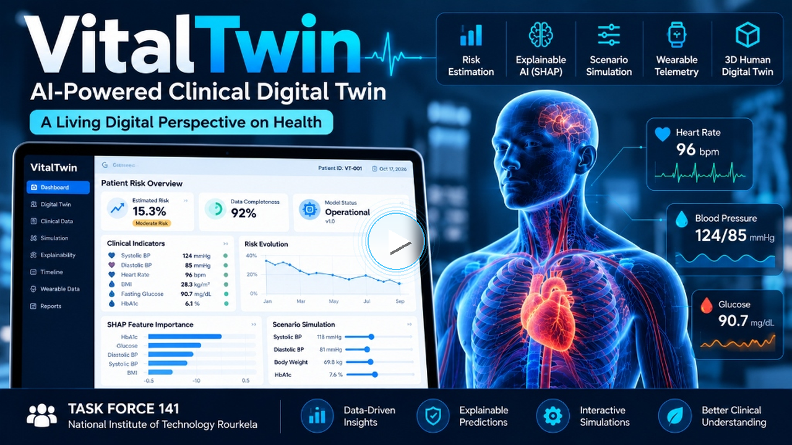

## Team Details

- **Team Name**: TASK FORCE 141
- **Team Members**:
  - Suguda Thakur Marndi
  - Shubham Prakash
  - Pratik Ranjan Jena

---

## College/Incubator Information

- **Institution**: National Institute of Technology Rourkela (NIT Rourkela)
- **Location**: Rourkela, Odisha, India

---

## Project Title

**VitalTwin — AI-Powered Clinical Digital Twin**

*Tagline: A Living Digital Perspective on Health*

---

## Problem Statement

Conventional cardiovascular healthcare relies predominantly on episodic clinical encounters and isolated diagnostic snapshots (such as annual health checks or acute clinic visits). These fragmented records fail to capture continuous hemodynamic trajectories, blood pressure variability, or the subtle physiological trends that precede clinical deterioration.

Because traditional electronic health records (EHRs) treat historical vitals as disconnected data points rather than an evolving continuum, clinicians lack longitudinal context for identifying emerging hypertension risk before acute decompensation or progression to Stage 2 hypertension occurs. Furthermore, standard predictive algorithms often function as opaque black boxes and evaluate static cross-sectional variables without accounting for multi-system physiological correlations, leaving clinicians without actionable or interpretable insights.

---

## Healthcare Use Case

VitalTwin addresses the limitations of isolated clinical records by constructing a continuous, longitudinal patient-state representation. The system aggregates 365 days of retrospective clinical history—including rolling blood pressure trajectories, heart rate variability, laboratory results, comorbidities, and medications across 132 engineered clinical features.

From this longitudinal representation, VitalTwin supports cardiovascular research through three core mechanisms:
1. **Longitudinal Risk Estimation**: Generates a model-based risk score for 365-day forward incident hypertension decompensation (progression to Stage 2 hypertension: $\ge 140$ mmHg systolic / $\ge 90$ mmHg diastolic, or an acute hypertensive event), mapped through empirical probability calibration with bootstrap confidence intervals.
2. **Explainable AI Insights**: Utilizes TreeSHAP to attribute risk scores to specific positive (risk-elevating) and negative (protective) physiological drivers, giving researchers interpretability into individual risk contributions.
3. **What-If Scenario Simulation**: Enables researchers to explore counterfactual clinical scenarios by modifying key physiological inputs (such as systolic blood pressure or BMI) and observing resulting model score shifts guided by biological covariance mappings.

> **Research Prototype Notice**: VitalTwin is an experimental research prototype intended solely for computational exploration and research into longitudinal cardiovascular modeling. It is not a clinically validated diagnostic tool, medical device, or clinical decision support system, and it has not been certified for direct patient diagnosis, treatment planning, or clinical management.

---

## Technical Stack

The technologies listed below represent components verified directly within the repository source code and dependency manifests (`package.json`, `backend/requirements.txt`):

- **Frontend Application**: [Next.js 16](https://nextjs.org) (React 19), [TypeScript 5](https://www.typescriptlang.org), [Tailwind CSS v4](https://tailwindcss.com), [Lucide React](https://lucide.dev)
- **3D Spatial Visualization**: [Three.js](https://threejs.org), [@react-three/fiber](https://r3f.docs.pmnd.rs), [@react-three/drei](https://github.com/pmndrs/drei)
- **Backend API Service**: [FastAPI 0.111+](https://fastapi.tiangolo.com), [Uvicorn 0.29+](https://www.uvicorn.org) (ASGI server), [Python 3](https://www.python.org)
- **Data Validation & Schemas**: [Pydantic v2](https://docs.pydantic.dev)
- **Data Processing**: [NumPy](https://numpy.org), [Pandas](https://pandas.pydata.org), [PyArrow](https://arrow.apache.org), [Joblib](https://joblib.readthedocs.io)
- **Machine Learning & Preprocessing**: [scikit-learn 1.6+](https://scikit-learn.org) (`Pipeline`, `ColumnTransformer`, `StandardScaler`, `SimpleImputer`, `OneHotEncoder`), [XGBoost 2.0+](https://xgboost.readthedocs.io) (`XGBoostClassifier`)
- **Explainability**: [SHAP 0.45+](https://shap.readthedocs.io) (`TreeExplainer`)
- **Interoperability & Streaming**: ABDM FHIR R4 JSON parser (`fhir_service.py`), Server-Sent Events (SSE) telemetry streaming (`wearable_service.py`)
- **Data Storage**: File-based structured JSON datasets (`demo_patients.json`, `registered_patients.json`), append-only SHA-256 hash-chained JSONL ledger (`inference_audit.jsonl`), and serialized `.joblib` model artifacts. *(Note: No external relational database or SQLAlchemy engine is used in the repository; persistence is strictly file-based).*
- **Testing**: [Pytest](https://pytest.org) test suite (`backend/tests/test_api.py`)

---

## AI/ML Model or Framework Details

### Model Pipeline Architecture
- **Framework**: scikit-learn `Pipeline` integrating `ColumnTransformer` preprocessing and an `XGBoostClassifier` ensemble, serialized in `backend/app/models/model_pipeline.joblib`.
- **Feature Space**: 132 engineered clinical features capturing rolling 365-day hemodynamic means, standard deviations, min/max extrema, trajectory slopes, pulse pressure, lab measurements, comorbidities, and medications.
- **Schema Validation**: Feature ordering and types are cryptographically enforced at inference time using schema hash `a4ddaedbdbc8bb07`.
- **Lookback & Horizon**: Features are aggregated over a strict 365-day retrospective lookback window ($[t - 365\text{d}, t]$) to predict incident hypertension decompensation within a 365-day forward horizon, ensuring zero future target leakage.

### Probability Calibration
Raw log-odds from the XGBoost ensemble are transformed into estimated risk probabilities via an empirical Platt scaling logistic calibrator (`backend/app/models/platt_calibrator.joblib`):
$$\hat{P}(Y=1) = \frac{1}{1 + \exp(-(0.4393 \cdot \text{logit} - 2.2073))}$$
Outputs include empirical 95% bootstrap confidence intervals representing calibration variance.

### Explainability and Simulation
- **SHAP Feature Attribution**: Integrated `shap.TreeExplainer` calculates patient-specific signed additive SHAP contributions, isolating positive (risk-increasing) and negative (protective) physiological factors.
- **What-If Simulation**: Correlated feature adjustments are managed by a covariance configuration (`lever_map.json`) to propagate physiological relationships across related variables (e.g., SBP adjustments propagate to pulse pressure and rolling extrema). What-if outputs represent model-based scenario comparisons and do not constitute evidence of causal treatment effects.

### Model Evaluation (Held-Out Test Set: N = 964 Patients)
Evaluation was conducted on a held-out test cohort containing 14 positive decompensation events:
- **Base Positive-Event Rate**: Approximately **1.46%** (14 positive cases out of 964 patients), reflecting extreme class imbalance.
- **ROC-AUC**: **0.8069** (95% CI: 0.691 – 0.908).
- **PR-AUC**: **0.0644** (reflecting the inherent difficulty of rare-event identification despite a 4.4-fold enrichment over the 0.0146 random baseline).
- **Brier Score**: **0.0138**.
- **Threshold Evaluation (0.7562)**: At the standard validation decision threshold of **0.7562**, the model detected **0 true positives** among the 14 held-out positive cases (14 false negatives, 0% recall). This confirms that static arbitrary thresholds fail under severe class imbalance, requiring operational alert-budgeting policies (e.g., top 5%, 10%, or 20% risk percentiles).

### Limitations and Disclosures
- **Synthetic Data**: The model was trained and evaluated solely on synthetic clinical records generated via Synthea. It has not been trained on or exposed to real patient records.
- **No Clinical Validation**: The model has not undergone external clinical validation, clinical trials, or prospective validation on diverse real-world cohorts, including Indian demographic populations.
- **Non-Clinical Probability**: Model scores represent statistical outputs of a research algorithm and must not be described or interpreted as proven clinical probabilities or diagnostic determinations.
- **Simulated Wearable Feeds**: Wearable telemetry streams in the repository are simulated demonstration feeds decoupled from core model inference weights.

---

## 15–20 Minute Demo Video

- **Project Demonstration Video**: [https://youtu.be/xzakIIPsmCc](https://youtu.be/xzakIIPsmCc)

*Click the preview thumbnail above to open and watch the project demonstration video.*

*Note on Video Verification*: The demonstration video link above is active and accessible. Because automated HTTP requests to YouTube return dynamic application shells without duration or visibility metadata, the exact video duration (15–20 minutes) and unlisted status cannot be programmatically verified from the repository and must be confirmed manually by the user.

---

## Open-Source License Details

- **License Status**: Missing / Not Yet Added
- **Repository Inspection Finding**: A direct inspection of the repository root confirms that no `LICENSE` or `LICENSE.txt` file currently exists.
- **Action Required**: The project does not currently have an open-source license committed. An official open-source license file (such as the MIT License or Apache License 2.0) must be created and committed to the repository root before open-source release to resolve this requirement.

---

## Architecture Diagram in PDF/PPT Format

- **Authoritative Architecture Blueprint (PDF)**: [docs/VitalTwin-Clinical-Digital-Twin-Architecture.pdf](docs/VitalTwin-Clinical-Digital-Twin-Architecture.pdf)

*The embedded preview above links directly to the authoritative one-page architecture PDF ([docs/VitalTwin-Clinical-Digital-Twin-Architecture.pdf](docs/VitalTwin-Clinical-Digital-Twin-Architecture.pdf)).*

---

## Presentation in PDF/PPT Format

- **Project Presentation Deck (PDF)**: [docs/VitalTwin-Project-Presentation.pdf](docs/VitalTwin-Project-Presentation.pdf)
- **Project Presentation Deck (PowerPoint PPTX)**: [Pramana_Clinical_Twin.pptx](Pramana_Clinical_Twin.pptx)

*The 9-page project presentation PDF ([docs/VitalTwin-Project-Presentation.pdf](docs/VitalTwin-Project-Presentation.pdf)) is maintained as a distinct deliverable from the one-page architecture blueprint.*
