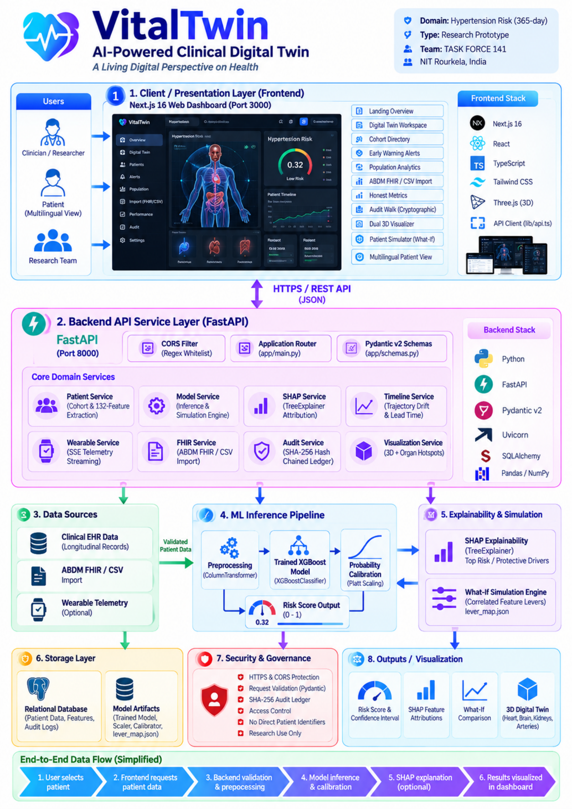
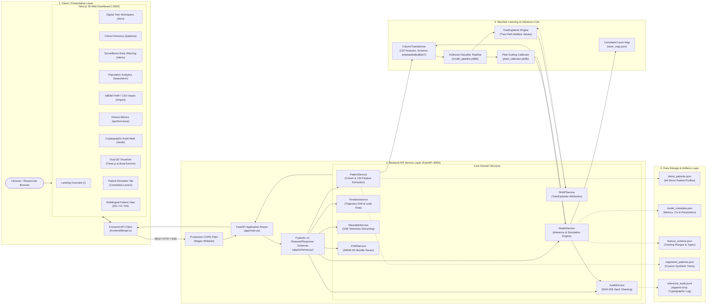
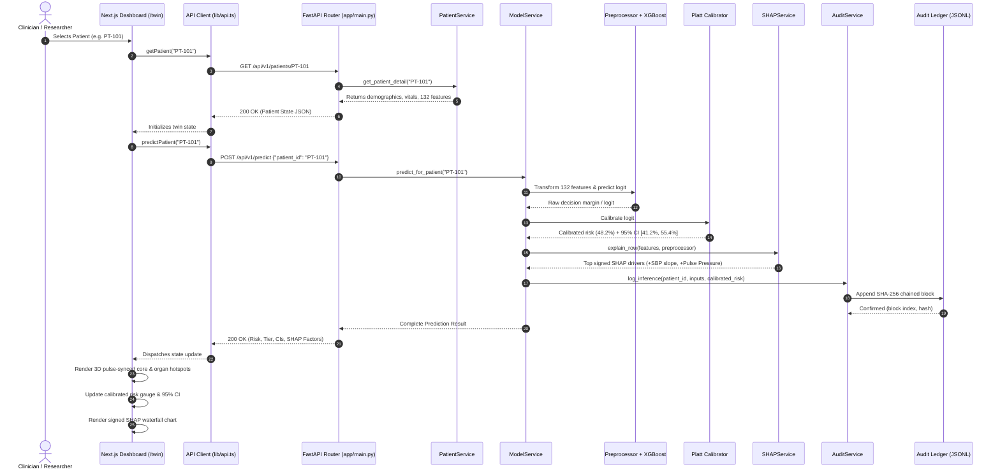
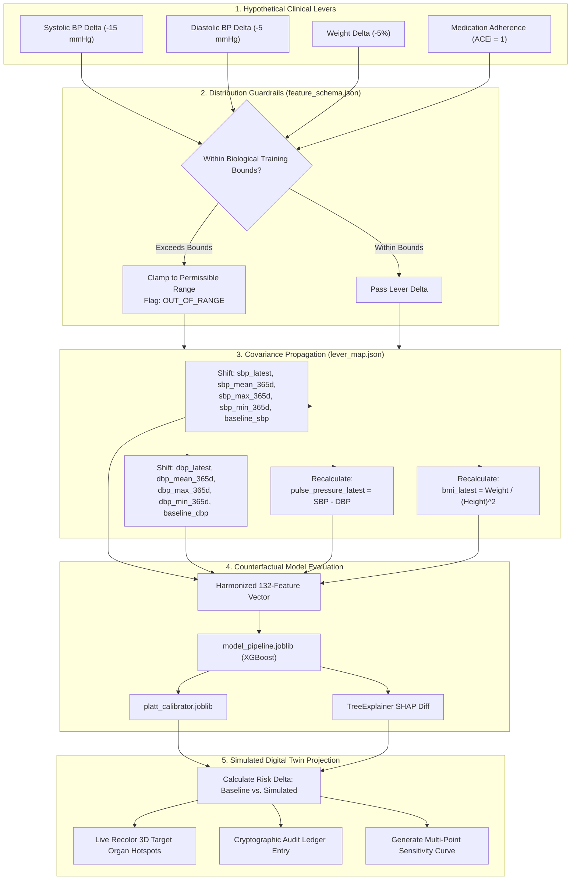

# VitalTwin — Technical Architecture & System Design

> **Project:** VitalTwin — AI-Powered Clinical Digital Twin  
> **Tagline:** A Living Digital Perspective on Health  
> **Team:** TASK FORCE 141  
> **Institution:** National Institute of Technology Rourkela (NIT Rourkela), Rourkela, Odisha, India  
> **Domain:** Longitudinal Clinical Digital Twin for 365-Day Hypertension Decompensation Risk  
> **Status:** Research Demonstration Prototype  

---

## Table of Contents

1. [Executive Overview](#1-executive-overview)
2. [End-to-End System Architecture](#2-end-to-end-system-architecture)
3. [Frontend Architecture](#3-frontend-architecture)
4. [Backend Service Architecture](#4-backend-service-architecture)
5. [Machine-Learning Inference Workflow](#5-machine-learning-inference-workflow)
6. [Detailed Data Flow Sequence](#6-detailed-data-flow-sequence)
7. [What-If Counterfactual Simulation Engine](#7-what-if-counterfactual-simulation-engine)
8. [API Communication Flow & Contract](#8-api-communication-flow--contract)
9. [Security, Governance & Responsible AI Controls](#9-security-governance--responsible-ai-controls)
10. [Verified Technology Stack](#10-verified-technology-stack)
11. [Known Clinical & Engineering Limitations](#11-known-clinical--engineering-limitations)
12. [Future Work & Roadmap](#12-future-work--roadmap)

---

## 1. Executive Overview

**VitalTwin** is an AI-powered clinical digital twin research prototype designed to model longitudinal cardiovascular health and predict 365-day hypertension decompensation risk.

Conventional Electronic Health Records (EHRs) operate as static, retrospective archives: clinical measurements are collected episodically, documenting hypertensive crises, heart failure, or cerebrovascular accidents only after irreversible target organ damage has occurred. 

VitalTwin maintains an evolving computational representation of patient cardiovascular physiology. It integrates:
- **132 engineered longitudinal clinical features** spanning 365-day rolling averages, variability, extrema, and directional trajectory slopes.
- **Trained Gradient-Boosted Tree Ensemble (`XGBoostClassifier`)** evaluated within a strict scikit-learn `ColumnTransformer` preprocessing pipeline.
- **Empirical Probability Calibration (Platt Scaling)** mapping uncalibrated tree logits into bounded probabilities with **95% empirical bootstrap confidence intervals**.
- **Game-Theoretic Explainability (TreeSHAP)** isolating signed patient-level positive (risk-elevating) and negative (protective) physiological drivers.
- **Coupled Counterfactual Simulator (What-If Lab)** propagating clinical intervention deltas across correlated physiological features via a covariance mapping engine (`lever_map.json`).
- **Dual 3D Spatial Visualization**: An abstract procedural hemodynamic telemetry core synchronized to patient pulse alongside a photorealistic rigged 3D human avatar (`BodyTwinViz`) with interactive target organ hotspots (Brain, Heart, Kidneys, Arteries).
- **Cryptographic Audit Ledger**: An append-only, SHA-256 hash-chained log guaranteeing tamper-evident traceability for every model inference and what-if simulation.

> [!IMPORTANT]
> **Research Prototype Notice**: VitalTwin is a computational research prototype. It has **not** undergone clinical trials or regulatory certification (CDSCO SaMD / US FDA) and does **not** provide autonomous diagnostic or therapeutic treatment prescriptions.

---

## 2. End-to-End System Architecture

[](VitalTwin-Clinical-Digital-Twin-Architecture.pdf)

> 📄 **Official Architecture Blueprint**: [Download the official one-page architecture diagram (VitalTwin-Clinical-Digital-Twin-Architecture.pdf)](VitalTwin-Clinical-Digital-Twin-Architecture.pdf).

The following diagram illustrates the verified architectural layers, runtime services, data stores, and communication pathways implemented in the repository:



---

## 3. Frontend Architecture

The frontend is implemented using **Next.js 16.4.0** (React 19.3.0, TypeScript 5.0+) with App Router architecture and Turbopack compiler.

### Directory Organization (`frontend/`)
```
frontend/
├── app/
│   ├── layout.tsx                   # Global root layout, theme scripts, and font injection
│   ├── page.tsx                     # Landing Overview, executive summary, KPI strip
│   ├── twin/page.tsx                # Core Digital Twin workspace
│   ├── patients/page.tsx            # Cohort directory table with sparklines
│   ├── patients/[id]/page.tsx       # Dynamic permalink redirect into /twin?patient=[id]
│   ├── alerts/page.tsx              # Surveillance early warning trajectory monitor
│   ├── population/page.tsx          # Cohort-wide epidemiological distributions
│   ├── import/page.tsx              # ABDM FHIR R4 Bundle and CSV device ingestion
│   ├── performance/page.tsx         # Honest metrics, reliability curves, alert budgets
│   ├── audit/page.tsx               # Cryptographic audit ledger inspector & verification
│   ├── india/page.tsx               # ICMR-INDIAB epidemiological context & IGH-IV alignment
│   ├── how-it-works/page.tsx        # Mathematical formulations (132 features, Platt, SHAP)
│   ├── model-card/page.tsx          # Standardized AI model card (Mitchell et al.)
│   ├── register/page.tsx            # 4-step patient onboarding wizard
│   └── about/page.tsx               # Responsible AI Humility Charter & Summit mission
├── components/
│   ├── Navbar.tsx                   # Top navigation with active route highlights & Summit badge
│   ├── ThemeProvider.tsx            # Dark / Light / System theme context with localStorage sync
│   ├── ConsentModal.tsx             # DPDP Act 2023 session consent modal
│   ├── LanguageSelector.tsx         # Multilingual switcher (EN, HI, KN)
│   └── digital-twin/                # Core digital twin visualization modules
│       ├── BodyTwinViz.tsx          # Photorealistic 3D Rigged Human Avatar with organ hotspots
│       ├── DigitalTwinViz.tsx       # Abstract Three.js procedural hemodynamic lattice
│       ├── RiskPanel.tsx            # Platt-calibrated gauge with 95% CI bands
│       ├── SHAPChart.tsx            # Signed TreeSHAP waterfall and bar attributions
│       ├── RiskReplay.tsx           # Historical snapshot scrubber & lead-time markers
│       ├── PatientSimulator.tsx     # Full What-If Lab with correlated levers
│       ├── WearablePanel.tsx        # Simulated Bluetooth telemetry & SSE streaming
│       ├── PatientView.tsx          # Plain-language multilingual patient communication view
│       ├── VitalCards.tsx           # Dense hemodynamic vitals tiles with clinical indicators
│       ├── LongitudinalCharts.tsx   # Trajectory charts with confidence bands
│       └── ClinicalReportModal.tsx  # Printable standardized 1-page clinical summary
├── lib/
│   ├── api.ts                       # Strongly-typed fetch client for all backend endpoints
│   ├── bodyMap.ts                   # 3D anatomical coordinate anchors for target organs
│   ├── i18n.tsx                     # Native React Context internationalization
│   └── types.ts                     # TypeScript data interfaces matching Pydantic schemas
└── public/models/
    ├── human-male.glb               # Rigged 3D male avatar mesh
    ├── human-female.glb             # Rigged 3D female avatar mesh
    └── generic-body.glb             # Neutral humanoid fallback mesh
```

### Visual Clinical Intelligence & Design Tokens
- **Design Tokens**: Standardized CSS variables defining glassmorphic surfaces (`--glass-surface`, `--glass-border`), high-contrast dark midnight navy canvas (`#07111F`), celestial primary blue (`#60A5FA`), and clinical risk color tiers (Low: `#34D399`, Moderate: `#FBBF24`, High: `#FB7185`).
- **Typography Scale**: High-density typography using Newsreader / Source Serif 4 (`font-serif`) for clinical display titles, Inter (`font-sans`) for controls, and JetBrains Mono (`font-mono tabular-nums`) for vitals, dates, percentages, and confidence bounds.

---

## 4. Backend Service Architecture

The backend is an asynchronous **FastAPI 0.111+** service hosted on a **Uvicorn ASGI server** (Python 3.11 / 3.13 / 3.14).

### Service Responsibilities

| Service Module | Source File | Core Functions & Responsibilities |
| :--- | :--- | :--- |
| **ModelService** | `app/services/model_service.py` | Loads `model_pipeline.joblib`, `platt_calibrator.joblib`, `feature_schema.json`, and `lever_map.json`. Executes inference via `score_row()`, clamps out-of-range inputs, and computes counterfactual scenarios via `simulate()`. |
| **PatientService** | `app/services/patient_service.py` | Indexes in-memory patient roster from `demo_patients.json` and `registered_patients.json`. Extracts the 132-feature vector from historical snapshots while strictly enforcing temporal lookback windows ($[t - 365\text{d}, t]$). |
| **SHAPService** | `app/services/shap_service.py` | Runs TreeExplainer on preprocessed feature matrices. Produces signed positive/negative factor impacts, applies human-readable medical labels (`FEATURE_LABELS`), and caches global importances (`shap_global.json`). |
| **TimelineService** | `app/services/timeline_service.py` | Calculates longitudinal risk trajectories across snapshots, detects slope acceleration (trajectory drift), and identifies surveillance early warning markers with lead-time days. |
| **WearableService** | `app/services/wearable_service.py` | Generates deterministic simulated peripheral wearable telemetry (resting HR, home BP, SpO2), evaluates out-of-office safety rules, and broadcasts real-time readings via Server-Sent Events (SSE). |
| **FHIRService** | `app/services/fhir_service.py` | Parses and validates Ayushman Bharat Digital Mission (ABDM) FHIR R4 JSON bundles. Maps LOINC codes (`8480-6` Systolic BP, `8462-4` Diastolic BP, `8867-4` Heart Rate) into patient features. |
| **AuditService** | `app/services/audit_service.py` | Maintains an append-only JSONL ledger (`inference_audit.jsonl`). Implements cryptographic SHA-256 hash chaining ($\text{SHA256}(\text{prev\_hash} \parallel \text{payload})$) and executes audit walk verification. |

---

## 5. Machine-Learning Inference Workflow

### Prediction Target & Temporal Design
- **Target Outcome**: 365-day Blood Pressure Decompensation, defined as progression to Stage 2 hypertension ($\text{SBP} \ge 140\text{ mmHg}$ or $\text{DBP} \ge 90\text{ mmHg}$) or an acute hypertensive event requiring escalation of care.
- **Observation Window**: Strictly bounded to the preceding 365 days prior to evaluation date ($[t - 365\text{d}, t]$).
- **Prediction Horizon**: Evaluated strictly over the subsequent 365 days ($(t, t + 365\text{d}]$). Zero post-baseline or future data leakage is permitted.

### The 132-Feature Extraction Space
Features are derived across 5 physiological categories:
1. **Longitudinal Hemodynamics**: Rolling 365-day SBP/DBP means, standard deviations, min/max extrema, first and last readings, and trajectory slopes ($\text{mmHg/year}$).
2. **Arterial Stiffness Indices**: Latest pulse pressure ($\text{SBP} - \text{DBP}$), mean pulse pressure over 365 days, and pulse pressure trend.
3. **Laboratory Analytes**: Fasting blood glucose, glycated hemoglobin (HbA1c), estimated glomerular filtration rate (eGFR), serum creatinine, total cholesterol, HDL, LDL, and triglycerides.
4. **Comorbidities & Demographics**: Age, sex, body mass index (BMI), weight, essential hypertension diagnosis, type 2 diabetes mellitus, cardiovascular disease (CVD), chronic kidney disease (CKD).
5. **Pharmacotherapy**: Active prescriptions for antihypertensives (ACEi, ARBs, CCBs, beta-blockers, thiazides), antidiabetics, and statins.

### Preprocessing & Model Execution
1. **ColumnTransformer Pipeline**:
   - `MissingIndicator`: Appends binary indicator flags for missing laboratory values.
   - `SimpleImputer`: Median imputation for skewed continuous lab measurements; most-frequent strategy for categorical flags.
   - `StandardScaler`: Standardizes numerical distributions to zero mean and unit variance.
   - `OneHotEncoder`: Encodes categorical demographic variables.
2. **XGBoost Classifier (`model_pipeline.joblib`)**:
   - Gradient-boosted decision tree ensemble trained with `scale_pos_weight` to account for class imbalance (1.46% base rate). Outputs raw decision margins (logits).
3. **Platt Scaling Logistic Calibrator (`platt_calibrator.joblib`)**:
   - Transforms raw uncalibrated logits into an empirical probability:
     $$\hat{P}(Y=1) = \frac{1}{1 + \exp(-(0.4393 \cdot \text{logit} - 2.2073))}$$
   - Generates empirical 95% bootstrap confidence intervals based on calibration variance.
4. **TreeSHAP Explainability**:
   - Decomposes the model logit into exact additive contributions:
     $$\text{Model Output} = \text{Expected Value} + \sum_{i=1}^{132} \phi_i$$
   - Each factor $\phi_i$ is signed: positive values represent risk-increasing drivers; negative values represent protective factors.

---

## 6. Detailed Data Flow Sequence

The following sequence diagram details the end-to-end communication from user interaction to frontend rendering:



---

## 7. What-If Counterfactual Simulation Engine

The **Patient Simulator** tab allows clinicians to explore hypothetical interventions (e.g. lowering systolic blood pressure by 15 mmHg, reducing weight by 5%, or adding an antihypertensive medication).

### Biological Covariance Propagation (`lever_map.json`)
In human physiology, blood pressure cannot drop in isolation without shifting rolling averages, minimums, maximums, and pulse pressure. The simulation engine enforces this biological realism:



> [!CAUTION]
> **Clinical Non-Equivalence Notice**: A reduction in model-estimated risk resulting from hypothetical input changes demonstrates mathematical model sensitivity; it does **not** constitute empirical clinical evidence of a therapeutic treatment effect.

---

## 8. API Communication Flow & Contract

All backend routes are mounted under `/api/v1` with root-level legacy redirects:

| Endpoint | Method | Input Contract | Output Contract | Service |
| :--- | :---: | :--- | :--- | :--- |
| `/api/v1/health` | `GET` | None | `{ status, version, schema_fingerprint }` | Main |
| `/api/v1/model/info` | `GET` | None | Model metadata, 95% CIs, limitations, calibration parameters | `ModelService` |
| `/api/v1/model/performance` | `GET` | None | Held-out test metrics, ROC-AUC, PR-AUC, alert budgets | `ModelService` |
| `/api/v1/patients` | `GET` | `limit`, `search`, `risk_tier` | Paginated array of cohort summaries with BP sparklines | `PatientService` |
| `/api/v1/patients/{id}` | `GET` | Patient ID (`path`) | Full digital twin state: demographics, vitals, 132 features | `PatientService` |
| `/api/v1/patients/register` | `POST` | Demographics, baseline vitals, lab values, medical history | Initialized twin state with derived 132 features | `PatientService` |
| `/api/v1/patients/{id}/readings` | `POST` | Newly acquired vitals (`sbp`, `dbp`, `hr`, etc.) | Appended snapshot with immediate recalibrated risk | `PatientService` |
| `/api/v1/predict` | `POST` | `patient_id` or raw feature vector | Calibrated risk, risk tier, 95% CI, signed SHAP factors | `ModelService` |
| `/api/v1/simulate` | `POST` | `patient_id`, `lever_deltas`, `preset_name` | Baseline vs. simulated comparison, shifted features, SHAP diff | `ModelService` |
| `/api/v1/patients/{id}/sensitivity` | `GET` | Patient ID (`path`) | Non-linear step-function curves across primary vitals | `ModelService` |
| `/api/v1/patients/{id}/timeline-risk` | `GET` | Patient ID (`path`) | Array of historical snapshots for risk replay scrubber | `TimelineService` |
| `/api/v1/alerts` | `GET` | `lookback_window`, `risk_threshold` | Patients flagged with trajectory drift and lead-time days | `TimelineService` |
| `/api/v1/stream/reading` | `POST` | Simulated telemetry reading | Broadcasts update to connected SSE clients | `WearableService` |
| `/api/v1/stream/{patient_id}` | `GET` | Patient ID (`path`) | Text/event-stream (Server-Sent Events) | `WearableService` |
| `/api/v1/import/fhir` | `POST` | ABDM FHIR R4 Bundle JSON | Extracted observation mapping report | `FHIRService` |
| `/api/v1/audit` | `GET` | `limit`, `offset` | Append-only audit ledger blocks | `AuditService` |
| `/api/v1/audit/verify` | `GET/POST`| None | Cryptographic walk verification: `{ valid, total_blocks }` | `AuditService` |

---

## 9. Security, Governance & Responsible AI Controls

### Cryptographic Audit Ledger
Every inference and counterfactual simulation execution creates an immutable block appended to `inference_audit.jsonl`:
- **Genesis Block**: Block index `0` links to standard genesis hash (`0*64`).
- **Hash Formulation**:
  $$\text{Block Hash} = \text{SHA256}(\text{prev\_hash} \parallel \text{timestamp} \parallel \text{model\_version} \parallel \text{schema\_fingerprint} \parallel \text{input\_hash} \parallel \text{calibrated\_risk} \parallel \text{tier})$$
- **Verification Walk**: The `/api/v1/audit/verify` endpoint iterates through every block in sequence, recalculating the hash and confirming cryptographic continuity. Any manual modification or tampering breaks the chain immediately.

### Indian Regulatory Alignment (DPDP Act 2023)
- **Data Minimization & Purpose Limitation**: The system only processes features strictly necessary for cardiovascular trajectory analysis.
- **Explicit Consent**: A global session modal (`ConsentModal.tsx`) ensures explicit acknowledgment of research terms before digital twin state can be inspected.
- **Zero Real Protected Health Information**: All default patient profiles originate from Synthea synthetic EHR datasets.

### Network Security & CORS Hardening
- **Production Hardened CORS**: Rejects wildcard `*` origins in production environments.
- **Vercel Preview Regex Support**: Supports dynamic preview deployments via `ALLOWED_ORIGIN_REGEX` (`^https:\/\/.*\.vercel\.app$`).

---

## 10. Verified Technology Stack

| Domain | Technology / Library | Version | Role in Architecture |
| :--- | :--- | :---: | :--- |
| **Frontend Framework** | [Next.js](https://nextjs.org) | `16.4.0` | React 19 App Router, Turbopack, static page generation |
| **UI Library** | [React](https://react.dev) | `19.3.0` | Declarative UI rendering, hooks, and Context state |
| **Language (Frontend)**| [TypeScript](https://www.typescriptlang.org) | `^5.0` | Strict static type safety across API contracts and state |
| **Styling** | [Tailwind CSS](https://tailwindcss.com) | `^4.0` | Utility CSS tokens, theme persistence, glassmorphic styles |
| **3D Rendering** | [Three.js](https://threejs.org) | `^0.186.1` | WebGL rendering for hemodynamic lattice & human avatar |
| **3D React Wrapper** | [@react-three/fiber](https://docs.pmnd.rs/react-three-fiber) | `^9.8.1` | Declarative Three.js scene graph in React |
| **3D Helpers** | [@react-three/drei](https://github.com/pmndrs/drei) | `^10.7.9` | GLTF loading, orbit controls, camera management |
| **Charts** | [Recharts](https://recharts.org) | `^3.10.1` | Longitudinal trajectory sparklines & reliability curves |
| **Icons** | [Lucide React](https://lucide.dev) | `^1.52.0` | Clinical UI iconography |
| **Backend Framework** | [FastAPI](https://fastapi.tiangolo.com) | `>=0.111.0`| High-performance asynchronous REST API |
| **ASGI Server** | [Uvicorn](https://www.uvicorn.org) | `>=0.29.0` | Asynchronous server implementation |
| **Data Validation** | [Pydantic](https://docs.pydantic.dev) | `>=2.7.0` | Request/response schema contracts and range enforcement |
| **Language (Backend)** | [Python](https://www.python.org) | `3.11–3.14`| Core server execution runtime |
| **Data Processing** | [Pandas](https://pandas.pydata.org) & [NumPy](https://numpy.org) | `>=2.0` / `>=1.26`| Feature manipulation and numerical matrix operations |
| **ML Framework** | [scikit-learn](https://scikit-learn.org) | `1.6.1` | Preprocessing `ColumnTransformer` & `Pipeline` |
| **Classifier Model** | [XGBoost](https://xgboost.readthedocs.io) | `>=2.0.0` | Gradient-boosted decision tree ensemble |
| **Explainability** | [SHAP](https://shap.readthedocs.io) | `>=0.45.0` | TreeExplainer signed feature attributions |
| **Model Serialization**| [Joblib](https://joblib.readthedocs.io) | `>=1.3.0` | Model artifact serialization and memory-mapped loading |
| **Columnar Data** | [PyArrow](https://arrow.apache.org) | `>=15.0.0` | Efficient tabular data structures |
| **Testing** | [Pytest](https://pytest.org) | `>=8.0.0` | Automated integration and regression test harness |

---

## 11. Known Clinical & Engineering Limitations

1. **Synthetic Training Provenance**: The XGBoost model was trained entirely on synthetic records generated by **Synthea** (representing US healthcare encounter coding). It does not contain real human patient clinical trajectories and does not capture hospital EHR noise, missingness, or coding idiosyncrasies.
2. **Absence of Clinical Validation**: The system has **not** undergone prospective clinical trials, retrospective clinical validation on Indian cohorts, or regulatory review by India's Central Drugs Standard Control Organisation (CDSCO) or the US FDA.
3. **Severe Class Imbalance Dynamics**: In the held-out test cohort of 964 patients, only 14 positive decompensation events occurred (1.457% base rate). A naive mathematical threshold of `0.7562` captured 0/14 events (0% recall), mandating the adoption of an **alert-budget operating policy** for practical surveillance.
4. **Decoupled Telemetry Feeds**: The simulated Bluetooth wearable telemetry streams are explicitly watermarked demonstrations and are decoupled from model training weights to prevent sensor noise from corrupting clinical predictions.
5. **Non-Causal Counterfactuals**: What-If scenario simulations reflect feature sensitivity within the decision tree ensemble; they do not represent causal pharmacological or physiological mechanisms.

---

## 12. Future Work & Roadmap

- **Prospective Indian Clinical Cohort Validation**: Validate model calibration and risk stratification against multicenter longitudinal cohorts across Indian Primary Health Centers (PHCs) and tertiary cardiology hospitals.
- **Full ABDM Health Information Exchange (HIE-CM)**: Transition from static FHIR bundle parsing to live consent-based health data exchange via Ayushman Bharat Digital Mission (ABDM) gateways using Ayushman Bharat Health Accounts (ABHA).
- **Causal Machine Learning**: Integrate Structural Causal Models (SCMs) and do-calculus to transition the What-If simulation engine from correlational tree sensitivity to causal interventional estimation.
- **On-Device Edge Inference**: Optimize model pipeline for low-power edge deployment on tablets used by Accredited Social Health Activist (ASHA) workers in rural settings.
